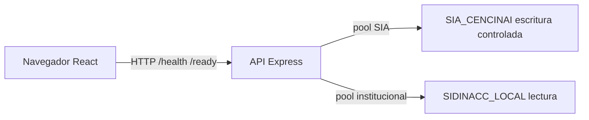

# Arquitectura de software — SIA-CENCINAI

Bootstrap del 2026-11-06. La arquitectura de datos ya implementada no se modifica. Decisión de modularidad: `docs/decisions/0001-modular-monolith.md`.

## Arquitectura general

Monolito modular. El frontend React y el backend Express son aplicaciones separadas dentro de un workspace npm. No hay microservicios ni una librería compartida: todavía no existe código de dominio usado por las dos aplicaciones.



El navegador no abre conexiones SQL. Las rutas bajo `/api` quedan cerradas hasta integrar la sesión institucional.

## Frontend

`apps/web` muestra una pantalla técnica de bienvenida. Responsabilidades actuales:

- arranque, variables públicas y estados de carga, éxito, dependencia no disponible y error de conexión;
- presentación accesible, sin datos personales ni flujos institucionales;
- llamada HTTP a la API mediante `loadTechnicalStatus`.

No hay gestor global de estado ni biblioteca de componentes. Los módulos de expediente, referencia, valoración, atención, programación y reportería no tienen pantallas.

La identidad visual usa la paleta documentada en `docs/institutional/DESIGN_ACCESSIBILITY_SPEC.md` solo donde el contraste de texto es suficiente. No se reconstruye el logotipo: el archivo oficial no está en el repositorio (`NEEDS_VALIDATION`). Esta entrega no certifica WCAG 2.2 AA. El objetivo de revisión sigue siendo ese nivel cuando se confirmen los criterios institucionales aplicables.

## Backend

`apps/api` separa:

| Pieza | Responsabilidad actual |
| --- | --- |
| `src/server.js` | Carga de configuración, escucha y cierre |
| `src/app.js` | Express, CORS, cabeceras y contrato de errores |
| `src/config` | Validación de entorno. No hay conexión de respaldo |
| `src/common` | Errores HTTP, registro y errores asíncronos |
| `src/modules/technical` | `GET /health` y `GET /ready` |
| `src/modules/institutional` | Búsqueda contextual y ficha básica. HU-005 a HU-009 |
| `src/infrastructure/database` | Dos clientes SQL |
| `src/infrastructure/integrations` | Adaptador SIDINACC, solo lectura |
| `src/infrastructure/persistence` | Resumen de casos desde la vista autorizada |
| `src/infrastructure/auth` | Frontera de sesión. Sin login productivo |

`createApp` no abre el puerto. Las pruebas HTTP usan esa instancia sin escuchar.

Errores distinguibles: validación `400`, no autorizado `401`, prohibido `403`, no encontrado `404`, conflicto `409`, infraestructura `503` e interno `500`. La respuesta interna no incluye la excepción del controlador ni la contraseña. Los registros redactan claves cuyo nombre parece un secreto.

## Módulos

`institutional` implementa la consulta contextual de este lote. El resto sigue reservado hasta su historia. No hay carpetas vacías.

| Módulo | Épica de la especificación v0.7 | Notas |
| --- | --- | --- |
| `institutional` | EP-01 | Implementado para búsqueda y ficha básica. No es una pantalla general de personas |
| `references` | EP-02 | |
| `assessments` | EP-03 | |
| `cases` | EP-04 | |
| `attentions` | EP-05 | |
| `scheduling` | EP-14 | |
| `reporting` | EP-08 | |

Las reglas funcionales irán en servicios del módulo, no en controladores ni en componentes React. Un módulo no debe importar el interior de otro; la integración entre ellos queda para el incremento que la necesite.

## SQL Server

Hay dos pools. Cada uno fija servidor, puerto, base, usuario y `appName`. El nombre de base tiene que ser `SIA_CENCINAI` o `SIDINACC_LOCAL`; no se arma con datos de la petición.

| Cliente | Base | Uso |
| --- | --- | --- |
| `sia` | `SIA_CENCINAI` | Disponibilidad, `dbo.schema_migracion` y `SELECT` sobre `dbo.caso_lista_establecimiento` |
| `sidinacc` | `SIDINACC_LOCAL` | Disponibilidad y consulta de personas, territorio, servicios y persona encargada. El filtro rechaza una segunda sentencia, con o sin punto y coma, `SELECT *`, `alias.*` y verbos que no son una lectura |

El filtro del cliente institucional es una defensa adicional, no un analizador SQL ni un sustituto del permiso en el motor. `writeFilterEnabled` indica que ese filtro está activo. `readOnly` en `/ready` es otra muestra: permisos de `INSERT`, `UPDATE`, `DELETE` y `sysadmin` del login. El pool reabre la conexión en la consulta siguiente si la anterior falló. Los tiempos de conexión y de solicitud salen de la configuración.

`/ready` informa si cada dependencia respondió y si el login institucional resultó de solo lectura. No devuelve usuario, contraseña, servidor ni el texto del error.

## Adaptador institucional

`createSidinaccAdapter` comprueba disponibilidad y delega la lectura de personas al lector institucional. La ubicación usa `CAF_FAMILIA_DETALLE` del período `SIDINACC_PERIOD_ID`. No usa `CAF_PERSONA_DETALLE`. `PER_idPersona` sigue siendo la clave de integración de la réplica v0.1 y no es el identificador definitivo (`NEEDS_VALIDATION`).

El contrato HTTP está en `docs/architecture/INSTITUTIONAL_PERSON_API.md`. Si la fuente no responde, la API sigue en ejecución, `/ready` queda `unavailable` y la búsqueda contextual responde `503`.

## Autenticación y autorización

`NEEDS_VALIDATION`: el mecanismo de sesión SIDINACC no está definido. No hay login, usuarios ni contraseñas del módulo. Sin credencial, `GET /api/*` responde `401` con `AUTHENTICATION_NOT_CONFIGURED`.

La frontera queda separada en proveedor de identidad, adaptador institucional, contexto interno, políticas de capacidad, resolución territorial y comprobación en ruta y servicio. El detalle está en `docs/architecture/AUTHORIZATION_MODEL.md` y en `docs/decisions/0002-authorization-model.md`.

En `development` y `test`, el servidor reconoce identidades sintéticas declaradas en código. El cliente presenta `Authorization: Bearer` con el identificador ya asociado por el servidor. Un encabezado de rol, capacidad, ámbito o establecimiento no cambia esa identidad. Esa vía no es la integración productiva y no existe cuando `NODE_ENV` no es `development` ni `test`. El arranque productivo sigue rechazado.

Las operaciones protegidas exigen una capacidad interna. La denegación es el resultado por defecto. Ocultar botones no se usa como autorización. Los endpoints técnicos `/health` y `/ready` son públicos y solo escuchan en `127.0.0.1` o `localhost`.

El arranque con `NODE_ENV=production` se rechaza. No hay configuración productiva.

## Seguridad de la réplica

La conexión institucional usa el login `sia_sidinacc_app` y abre `SIDINACC_LOCAL`. No es `sysadmin` ni miembro de otros roles de servidor. Sus permisos efectivos de servidor son `CONNECT SQL` y `VIEW ANY DATABASE`; el segundo lo hereda de `public`. El usuario de base, con el mismo nombre, pertenece solo a `sia_sidinacc_reader_role`. Ese rol es miembro de `db_datareader` y conserva los `DENY` de `INSERT`, `UPDATE`, `DELETE` y `ALTER` que ya definía el esquema. `SELECT` cubre la superficie de la réplica porque el rol reutiliza `db_datareader`; no se concedió `SELECT` objeto por objeto ni se amplió el rol.

La contraseña no está en el repositorio. `cencinai_reader` continúa sin usuario en la base y no se reutilizó. `sia_sidinacc_reader` sigue siendo `WITHOUT LOGIN`. `sia_sidinacc_app` no tiene usuario en `SIA_CENCINAI`, `HAS_DBACCESS` devuelve 0 y una consulta de tres partes hacia esa base falla con el error 916. El encadenamiento entre bases está desactivado y `guest` no tiene `CONNECT` en `SIA_CENCINAI`.

`readOnly` sale de la sonda de permisos del login. Con esta cuenta es `true`. `writeFilterEnabled` solo indica que el filtro del adaptador está activo; no sustituye esa sonda. Si las dos conexiones comparten usuario, el arranque lo advierte. La sonda deja de informar solo lectura cuando ese login puede escribir o es `sysadmin`.

La conexión de `SIA_CENCINAI` usa `sia_cencinai_app`. No es la credencial de despliegue. No pertenece a roles fijos de servidor ni a `db_owner`, `db_datawriter`, `db_ddladmin` o `db_datareader`. Tampoco es miembro de `rol_aplicacion`, `rol_establecimiento`, `rol_lectura_regional`, `rol_lectura_nacional`, `rol_catalogo` ni `rol_auditoria`, y no puede ejecutar `ops.cerrar_caso`. En la base del módulo sus permisos efectivos de base siguen siendo `CONNECT` y las dos vistas de definición de claves de cifrado que `public` ya trae. Por eso la sonda de `/ready` sigue informando `readOnly: true`: mira `INSERT` de base, no el DML de objeto.

El `SELECT` alcanza `dbo.schema_migracion` y `dbo.caso_lista_establecimiento`. Ese segundo permiso lo aplica `database/sia-cencinai/security/010_grant_case_list_to_app.sql`. El Lote 02 agrega, con `database/sia-cencinai/security/020_grant_reference_writes_to_app.sql`, `SELECT` e `INSERT` sobre `vinculo_persona`, `ref_referencia`, `ref_contexto`, `ref_motivo`, `ref_impresion` y `aud_evento`; `SELECT` sobre `cat_item` y `cat_version`; y `SELECT`, `INSERT`, `DELETE` más `UPDATE` de columnas sobre `bor_captura`. No abre `ses_valoracion`, `caso_ai`, planes, atenciones ni documentos. No hay `UPDATE` ni `DELETE` de `ref_referencia`. No tiene acceso a `SIDINACC_LOCAL`. La suite de permisos usa estas dos cuentas y no abre un pool administrativo.

## Contrato técnico

`GET /health`

```json
{ "status": "ok", "service": "sia-cencinai-api", "environment": "development" }
```

`GET /ready` con dependencias disponibles:

```json
{
  "status": "ready",
  "checks": {
    "sia": { "status": "up", "database": "SIA_CENCINAI" },
    "sidinacc": { "status": "up", "database": "SIDINACC_LOCAL", "readOnly": true }
  }
}
```

Si una dependencia falla, el estado HTTP es `503` y `status` es `unavailable`. Un error de cliente usa `{ "error": { "code": "...", "message": "..." } }`.

El navegador llama a `VITE_API_BASE_URL` o, en su defecto, `http://127.0.0.1:3001`. CORS solo refleja `CORS_ORIGIN`.

## Ejecución

Node corre en el host. SQL Server sigue siendo el contenedor existente `sidinacc-local-sql`, publicado en `1433`. Desde el host la dirección es `127.0.0.1`. Si más adelante la API corriera dentro de otro contenedor, `localhost` apuntaría a ese contenedor y haría falta `host.docker.internal` en Docker Desktop. Este bootstrap no agrega ese contenedor ni modifica el de SQL Server.

## Riesgos y pendientes

- `sia_cencinai_app` todavía no tiene la escritura funcional de `rol_aplicacion`. Ese otorgamiento queda para la historia que lo necesite; no se concede para hacer pasar pruebas.
- `VIEW ANY DATABASE`, concedido a `public`, permite ver nombres de bases. No permite conectarse a la base de la otra cuenta.
- Cada login entra a `master` como `guest`. Es el comportamiento predeterminado del motor y no se modificó.
- Contrato de sesión SIDINACC.
- Identificador institucional definitivo de persona.
- Logotipo y certificación de accesibilidad.
- Exposición de red, CORS y alojamiento cuando exista un ambiente distinto del equipo local.
- El filtro de SQL institucional puede rechazar una consulta legítima que use una palabra reservada fuera de una cadena. Se ajusta en el incremento que la necesite.
