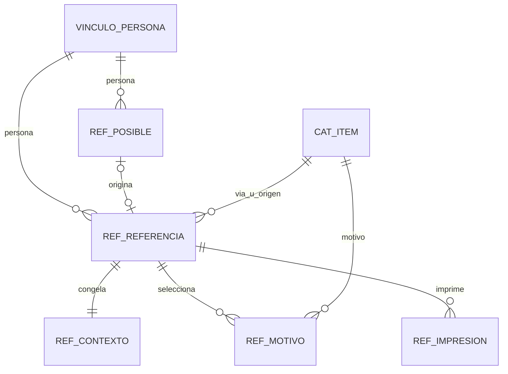
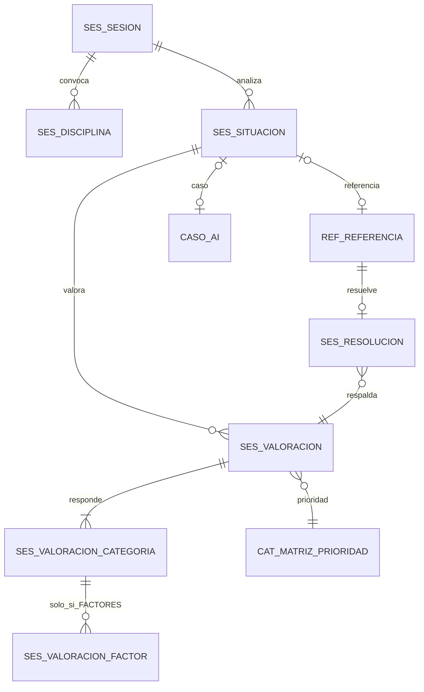
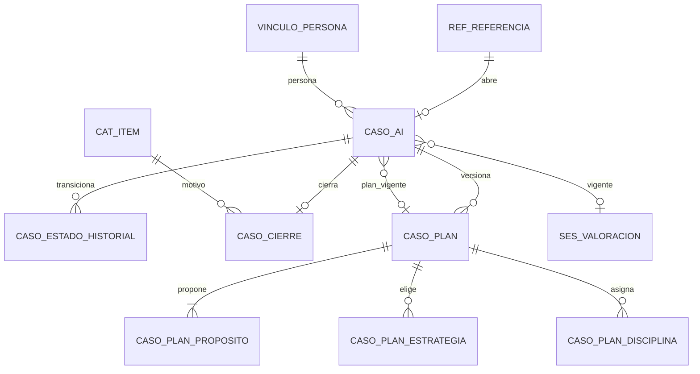
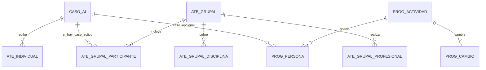
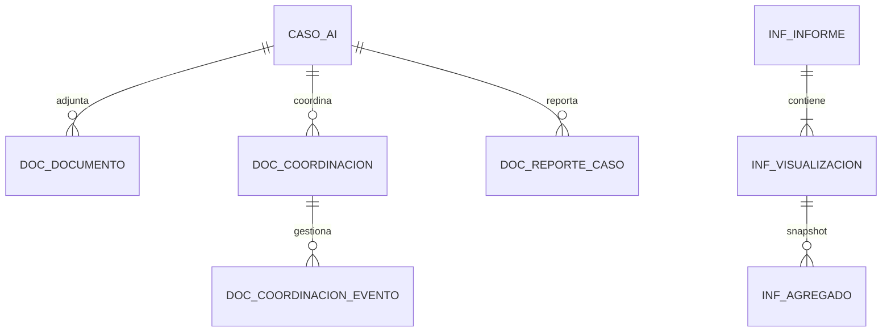
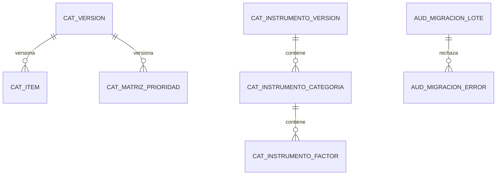

# Diagramas por dominio — diseño seleccionado

Complementan `DATABASE_DESIGN_SELECTED.mmd`. No lo sustituyen. Las cardinalidades son las del documento técnico. Una línea hacia `CAT_ITEM` representa la FK compuesta `(item_id, codigo_catalogo)` descrita en el diseño seleccionado. No aparece ninguna relación de caso sucesor ni hacia `SIDINACC_LOCAL`.

`caso_lista_establecimiento` es una vista y no entra en los diagramas.

## 1. Referencias y posibles referencias

La referencia enviada es obligatoria en su contexto histórico. La posible referencia puede no llegar a crear referencia. El control de consecutivo y el código regional no cuelgan de la persona.

`REF_CONSECUTIVO_CONTROL` y `CAT_CODIGO_REGION_REFERENCIA` no tienen FK hacia la referencia. Evitan acoplar el contador al borrado de un envío. El consecutivo ya asignado vive en `REF_REFERENCIA` y es único.

## 2. Sesiones y valoraciones

Una situación apunta a una referencia o a un caso, no a los dos. La valoración confirmada exige categorías. Los factores solo existen si la respuesta de esa categoría es `FACTORES`. La resolución es opcional respecto de la referencia y, si existe, es una sola.

No hay tabla de sugerencia de riesgo. Riesgo y protección son columnas profesionales de `SES_VALORACION`, y la prioridad entra solo si la tupla existe en la matriz.

## 3. Casos y planes

La referencia abre como máximo un caso. El cierre es cero o uno y no apunta a otro caso. El plan vigente es una de las versiones. La valoración vigente es una FK, no una copia de los factores.

`destino_establecimiento_id` en el cierre es un dato documental. No es FK a `CASO_AI`.

## 4. Atenciones y programación

La grupal no tiene caso en la cabecera. El participante puede tener caso nulo. La programación no se relaciona con la atención: no hay línea entre `PROG_ACTIVIDAD` y `ATE_*`.

`asistio` nulo no cuenta como atención efectiva. Una actividad sin filas en `PROG_PERSONA` es general.

## 5. Documentos, coordinaciones e informes

El reporte individual no toca el estado del caso. El informe analítico guarda de una a muchas visualizaciones; la regla de cinco a doce es de transacción y no cabe en la cardinalidad del diagrama. El agregado no apunta a personas.

## 6. Catálogos, auditoría e integración

El vínculo de persona es la única identidad persistida. No hay entidad de usuario ni de establecimiento autorizado. Auditoría y borrador no tienen FK al expediente: guardan identificadores opacos para no arrastrar borrados ni textos por cascada. La migración solo relaciona lote y error.

Quedan en el diagrama global, sin FK de negocio: `CAT_CODIGO_REGION_REFERENCIA`, `REF_CONSECUTIVO_CONTROL`, `BOR_CAPTURA` y `AUD_EVENTO`.

La integración con SIDINACC no se dibuja. `per_id_persona` coincide en valor con `CAF_PERSONA.PER_idPersona` y no es clave foránea.
