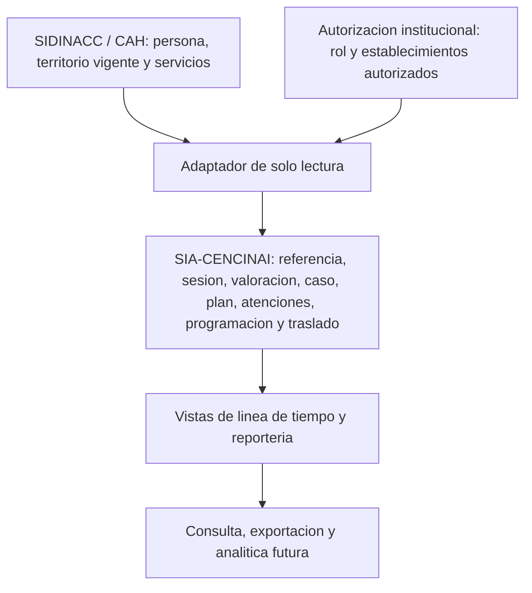

# Arquitectura de datos seleccionada — SIA-CENCINAI

**Fecha:** 31 de octubre de 2026

**Estado:** arquitectura lógica revisada. No es DDL ni implementación.

**Origen de la decisión:** `DATABASE_DESIGN_ANALYSIS.md`, propuesta 1, después de la revisión para SQL Server.

**Decisión de la revisión:** `APPROVED_WITH_CHANGES`, con los cambios ya incorporados aquí.

---

## 1. Visión

SIA-CENCINAI persiste el proceso de Atención Interdisciplinaria. SIDINACC/CAH sigue siendo el maestro de la persona, de su ubicación vigente y de sus servicios. `SIDINACC_LOCAL` solo simula esa fuente en desarrollo.

El caso de A.I. es el episodio de responsabilidad de una Oficina Local. La persona se referencia por `PER_idPersona`. Cuando el caso se traslada, el episodio de origen se cierra y conserva su historia. Si destino confirma la continuidad, nace otro caso, encadenado por el traslado.

Los hechos confirmados se agregan. La decisión profesional y el plan se versionan. La línea de tiempo, la última atención, los casos sin atención y las consolidaciones se leen; no se almacenan como una segunda verdad.

Regional y Nacional consultan esas lecturas. La edición operativa permanece en la Oficina Local. El establecimiento crea y consulta referencias y ve la lista mínima del caso.

---

## 2. Principios de este modelo

1. El equipo decide. La base guarda la decisión y la regla con la que se calculó la prioridad.
2. Vigilancia no es un caso. Un vínculo de detección no admite.
3. No se redigita la ficha institucional. Se congela el contexto de la referencia.
4. Un caso tiene muchas atenciones. Una grupal es una fila.
5. El traslado no mueve ni borra la historia de origen.
6. Un reporte no cierra el caso. Una programación no acredita atención.
7. Los identificadores de SIDINACC no tienen llave foránea dentro de SIA.
8. Lo exploratorio se puede agregar al lado de la decisión profesional, sin escribir encima.

---

## 3. Dominios

| Dominio | Responsabilidad |
| --- | --- |
| Referencia | Envío, consecutivo, snapshot, motivos, impresión y vínculo opcional con una detección externa. |
| Sesión y valoración | Sesión del equipo, respuesta por categoría, factores, niveles profesionales y resolución. |
| Caso | Episodio territorial, estado, decisión vigente y plan vigente. |
| Atención | Hecho individual y hecho grupal. |
| Seguimiento | Documentos, coordinaciones, reportes de caso y cierre. |
| Traslado | Responsabilidad que termina y continuidad que puede empezar. |
| Programación | Agenda de la Oficina Local y su historia de cambios. |
| Configuración | Catálogos, instrumento, matriz y rangos analíticos de edad. |
| Soporte | Borradores, migración y salidas documentales. |

---

## 4. Integración y propiedad

| Dato | Propiedad |
| --- | --- |
| `PER_idPersona`, nombre vigente, nacimiento, sexo, familia, establecimiento actual, servicios del período | `SOURCE_OWNED` en SIDINACC. Pendiente de UTIC si la llave de interoperabilidad sigue siendo `PER_idPersona`. |
| Establecimientos autorizados y rol | Autorización institucional. SIA no los duplica. |
| Snapshot de la referencia y nombres territoriales del traslado | `SNAPSHOT` en SIA. |
| Proceso de A.I. | `SYSTEM_OWNED`. |
| Prioridad, embudos, última atención, vencimiento de agenda | `DERIVED`, salvo la prioridad ya calculada, que se guarda como evidencia. |
| Catálogos, instrumento, matriz, rangos de edad | `CONFIGURATION`. |
| Actores, fechas de registro, impresiones, lotes | `AUDIT`. |

El adaptador es la única puerta hacia las tablas institucionales. El dominio de SIA no consulta `CAF_*` ni `RCS_*`.

Columnas de ámbito en las filas operativas: `region_id`, `oficina_local_id`, `establecimiento_id`, como enteros institucionales. Sirven para filtrar y autorizar en la capa de datos. Los nombres vigentes se resuelven en la fuente. Los nombres históricos salen del snapshot.

---

## 5. Historial

| Mecanismo | Dónde |
| --- | --- |
| Hecho inmutable | Referencia enviada, valoración, resolución, atención, documento, reporte, traslado, evento de estado del caso. |
| Append-only con apuntador vigente | `caso_decision_profesional`, `plan_atencion_version`, `coordinacion_estado_evento`, `actividad_programada_transicion`. |
| Snapshot | Referencia y traslado. |
| Etiqueta congelada | Cada selección de catálogo o factor. |
| Vista | Línea de tiempo y métricas. |
| Borrador descartable | `borrador_captura`, hasta confirmar. |

No hay borrado lógico general. Un borrador se puede eliminar. Una fila clínica confirmada no.

Ciclo controlado: `caso_ai.decision_vigente_id` y `caso_ai.plan_vigente_id` son nulos en el alta. Primero se inserta el caso, después la decisión o el plan, después se actualiza el apuntador. Misma transacción.

---

## 6. Catálogos y versionamiento

`item_catalogo` es estable. `conjunto_catalogo` publica una vigencia. `conjunto_catalogo_item` dice qué ítems formaban esa publicación. La fila de negocio guarda el `item_id` y la `etiqueta_snapshot`.

Tipos de conjunto:

`VIA_ATENCION`, `ORIGEN_REFERENCIA`, `CATEGORIA_MOTIVO`, `MOTIVO_REFERENCIA`, `DISCIPLINA`, `ESTRATEGIA`, `FRECUENCIA`, `TIPO_ACTIVIDAD_PROGRAMADA`, `TIPO_ATENCION_GRUPAL`, `MOTIVO_CANCELACION`, `INSTITUCION_EXTERNA`, `TIPO_DOCUMENTO`, `TIPO_REPORTE`, `MOTIVO_CIERRE`, `MOTIVO_TRASLADO`, `ESTADO_COORDINACION`.

Los motivos de referencia usan `item_padre_id` hacia su categoría. Los factores de riesgo de la referencia usan `ambito_codigo`: `INDIVIDUAL`, `HOGAR_FAMILIAR` o `COMUNITARIO`.

El instrumento de valoración no entra en ese catálogo genérico. Tiene versión, categorías y factores, porque la categoría requerida y la respuesta `Ninguno` son reglas del instrumento.

`nivel_escala` fija los códigos de riesgo (`ALTO`, `MODERADO`, `BAJO`), protección (`ALTA`, `MODERADA`, `BAJA`) y prioridad (`ALTO`, `MODERADO`, `BAJO`). `version_matriz_prioridad` y `celda_matriz_prioridad` guardan la combinación. Las celdas concretas de RN-009 están pendientes de la fuente institucional. El modelo no las inventa.

La vía de atención `Urgencia` / `No inmediata` no es una prioridad.

---

## 7. Entidades

Las llaves primarias propias son `bigint` identidad. Los textos narrativos son textos largos. El resto de los textos de negocio son textos acotados en el DDL futuro; aquí no se fijan tamaños. Todo instante es `datetime2` y toda fecha institucional es `date`.

### referencia

| Campo | Contenido |
| --- | --- |
| Propósito | Referencia ya enviada. El borrador no vive aquí. |
| PK | `referencia_id` |
| FK | Vía de atención, origen y lote de migración opcional, hacia catálogo o lote. |
| Atributos | `persona_institucional_id`; fecha de referencia; estado `PENDIENTE_REVISION`, `ADMITIDA` o `NO_REQUIERE_AI`; acciones previas; resultados previos; información complementaria; consecutivo completo; año y secuencia; identificadores y nombres congelados de Región, Oficina Local y establecimiento; nombre, nacimiento, sexo y edad de referencia; encargada, relación, contacto y dirección; responsable y remitente; `enviada_en`; procedencia `SIDINACC`; `rowversion`. |
| Cardinalidad | Una persona, muchos envíos. Una referencia, muchos casos solo cuando hay continuidad posterior; una sola admisión. |
| Ownership | `SYSTEM_OWNED` con snapshot. |
| Historial | Inmutable salvo el paso de estado al resolver o admitir. |
| Notas | El consecutivo usa el establecimiento de la persona, no el de quien redacta. Patrón DNCC-DRXX-OLXXX-{establecimiento}-REF-XXX-20XX. Índice único del consecutivo. Índice por oficina, estado y fecha de envío. |

### referencia_motivo

| Campo | Contenido |
| --- | --- |
| Propósito | Motivo seleccionado y su especificación. |
| PK | `referencia_motivo_id` |
| FK | `referencia_id`, `item_id` del motivo. |
| Atributos | `etiqueta_snapshot`, especificación nula si no aplica. |
| Cardinalidad | 1:N desde la referencia. Único por referencia e ítem. |
| Ownership | `SYSTEM_OWNED`. |
| Historial | Se invalida la especificación si el motivo se retira antes del envío. Después del envío la fila queda. |
| Notas | Varios motivos no se excluyen entre sí. |

### referencia_servicio_snapshot

| Campo | Contenido |
| --- | --- |
| Propósito | Modalidades o servicios visibles al enviar. |
| PK | `referencia_servicio_id` |
| FK | `referencia_id` |
| Atributos | Identificador institucional del servicio, descripción, tipo de cliente y período, todos congelados. |
| Cardinalidad | 1:N. |
| Ownership | `SNAPSHOT`. |
| Historial | Inmutable. |
| Notas | No se actualiza si el período siguiente cambia los servicios. |

### referencia_salida

| Campo | Contenido |
| --- | --- |
| Propósito | Generación o impresión, separada del envío. |
| PK | `referencia_salida_id` |
| FK | `referencia_id` |
| Atributos | Tipo de salida, actor, `generada_en`. |
| Cardinalidad | 1:N. |
| Ownership | `AUDIT`. |
| Historial | Append-only. |
| Notas | No modifica la referencia. |

### consecutivo_referencia

| Campo | Contenido |
| --- | --- |
| Propósito | Evitar dos consecutivos iguales bajo concurrencia. |
| PK | `establecimiento_id` + `anio` |
| FK | Ninguna hacia SIDINACC. |
| Atributos | `ultimo_valor`. |
| Cardinalidad | Una fila por establecimiento y año. |
| Ownership | `SYSTEM_OWNED`. |
| Historial | Solo el último valor. El número ya emitido queda en la referencia. |
| Notas | Actualización con bloqueo de la fila dentro de la transacción de envío. |

### vinculo_deteccion_referencia

| Campo | Contenido |
| --- | --- |
| Propósito | Recordar qué resultado institucional ya originó una referencia, para no duplicar la alerta. |
| PK | `vinculo_deteccion_id` |
| FK | `referencia_id` |
| Atributos | Sistema fuente, clave del resultado, criterio, versión del criterio, período o fecha observada, persona y establecimiento. |
| Cardinalidad | 0..1 por referencia. Único por sistema y clave de resultado. |
| Ownership | `SYSTEM_OWNED`. La ficha de vigilancia no se copia. |
| Historial | Inmutable. |
| Notas | Si la persona no confirma la referencia, no hay fila y la alerta sigue pendiente. No abre un caso. |

### sesion_interdisciplinaria

| Campo | Contenido |
| --- | --- |
| Propósito | Sesión real del equipo. |
| PK | `sesion_id` |
| FK | Ninguna hacia la programación. |
| Atributos | Oficina Local; fecha; hora de inicio; hora de fin; lugar; estado `REGISTRADA`; actores; `rowversion`. |
| Cardinalidad | 1:N asuntos y disciplinas. |
| Ownership | `SYSTEM_OWNED`. |
| Historial | Mutable mientras se incorporan asuntos. |
| Notas | El ciclo de vida posterior a `REGISTRADA` está `NEEDS_VALIDATION`. Esta sesión no es la actividad programada del mismo nombre. |

### sesion_disciplina

| Campo | Contenido |
| --- | --- |
| Propósito | Disciplinas participantes. |
| PK | `sesion_disciplina_id` |
| FK | `sesion_id`, `item_id`. |
| Atributos | `etiqueta_snapshot`. |
| Cardinalidad | N:M. Único por sesión e ítem. |
| Ownership | `SYSTEM_OWNED`. |
| Historial | La etiqueta queda congelada. |
| Notas | Sin disciplina genérica `Otra` en el conjunto vigente. |

### sesion_asunto

| Campo | Contenido |
| --- | --- |
| Propósito | Referencia o caso incluido en la sesión. |
| PK | `sesion_asunto_id` |
| FK | `sesion_id`; `referencia_id` nulo; `caso_id` nulo. |
| Atributos | Momento en que se agregó y actor. |
| Cardinalidad | 1:N. Al menos una de las dos referencias. Único por sesión y referencia, y por sesión y caso, cuando el identificador existe. |
| Ownership | `SYSTEM_OWNED`. |
| Historial | Append-only. |
| Notas | La misma referencia no se agrega dos veces. |

### valoracion_situacional

| Campo | Contenido |
| --- | --- |
| Propósito | Valoración confirmada de una situación dentro de una sesión. |
| PK | `valoracion_id` |
| FK | `sesion_id`, `version_instrumento_id`; `referencia_id` y `caso_id` nulables con al menos uno. |
| Atributos | Resumen o comentarios; `riesgo_nivel_id`; `proteccion_nivel_id`; actor; `confirmada_en`. |
| Cardinalidad | Varias por sesión. La de apertura del caso queda citada por la decisión. |
| Ownership | `SYSTEM_OWNED`. |
| Historial | Inmutable al confirmar. Otra sesión puede confirmar otra valoración. |
| Notas | Los niveles no se calculan desde los factores. No hay intensidad, frecuencia ni persistencia. Revalorar un caso ya abierto está `NEEDS_VALIDATION`; la tabla lo permite sin imponerlo. |

### valoracion_categoria_respuesta

| Campo | Contenido |
| --- | --- |
| Propósito | Dejar constancia de que una categoría fue respondida. |
| PK | `valoracion_categoria_id` |
| FK | `valoracion_id`, `categoria_id`. |
| Atributos | `respuesta`: `FACTORES` o `NINGUNO`. |
| Cardinalidad | Una fila por categoría respondida. Único por valoración y categoría. |
| Ownership | `SYSTEM_OWNED`. |
| Historial | Inmutable. |
| Notas | La ausencia de fila significa pendiente. `NINGUNO` significa revisión sin factores. No es un factor. |

### valoracion_factor

| Campo | Contenido |
| --- | --- |
| Propósito | Factor elegido y especificación opcional. |
| PK | `valoracion_factor_id` |
| FK | `valoracion_id`, `factor_id`. |
| Atributos | `etiqueta_snapshot`, especificación. |
| Cardinalidad | 1:N. Único por valoración y factor. |
| Ownership | `SYSTEM_OWNED`. |
| Historial | Inmutable. |
| Notas | Solo puede existir si la categoría de ese factor está en `FACTORES`. Un factor abierto del instrumento usa la especificación; no reintroduce un “otro motivo” de referencia. |

### resolucion_ai

| Campo | Contenido |
| --- | --- |
| Propósito | Decisión de si requiere Atención Interdisciplinaria. |
| PK | `resolucion_id` |
| FK | `referencia_id` única, `sesion_id`, `valoracion_id`. |
| Atributos | `decision`: `REQUIERE_AI` o `NO_REQUIERE_AI`; justificación; actor; `decidida_en`. |
| Cardinalidad | Una resolución confirmada por referencia. |
| Ownership | `SYSTEM_OWNED`. |
| Historial | Inmutable. |
| Notas | `NO_REQUIERE_AI` exige justificación y no abre caso. La referencia pasa a `NO_REQUIERE_AI`. |

### caso_ai

| Campo | Contenido |
| --- | --- |
| Propósito | Episodio de responsabilidad territorial. |
| PK | `caso_id` |
| FK | `persona` solo como identificador institucional; `referencia_origen_id` nulo en migración sin referencia; `resolucion_id` nulo en continuidad o migración; `sesion_apertura_id` nulo; `caso_predecesor_id` nulo; `decision_vigente_id` nulo; `plan_vigente_id` nulo; `lote_migracion_id` nulo. |
| Atributos | `base_apertura`: `ADMISION`, `CONTINUIDAD_TRASLADO` o `MIGRACION`; Región, Oficina Local y establecimiento responsables; estado `ACTIVO`, `CERRADO` o `CERRADO_POR_TRASLADO`; `fecha_apertura`; actores; `rowversion`. |
| Cardinalidad | Una persona, muchos casos. Una referencia, un caso de admisión como máximo. |
| Ownership | `SYSTEM_OWNED`. |
| Historial | El estado actual se consulta aquí. La historia de estado, decisión y plan está en las tablas hijas. |
| Notas | El territorio es el de la responsabilidad, no el de la ficha familiar vigente. Índice filtrado único de admisión por referencia. Continuidad exige predecesor. Admisión nativa exige referencia. |

### caso_decision_profesional

| Campo | Contenido |
| --- | --- |
| Propósito | Evidencia de riesgo, protección y prioridad. |
| PK | `decision_id` |
| FK | `caso_id`; `valoracion_id` nulo si se cita una decisión anterior; `decision_origen_id` nulo; tres niveles; `version_matriz_id`. |
| Atributos | `vigente_desde`, actor, motivo de un cambio posterior. |
| Cardinalidad | 1:N por caso. El caso apunta a una vigente. |
| Ownership | `SYSTEM_OWNED`. El resultado es evidencia de un cálculo, no un derivado suelto. |
| Historial | Append-only. Una matriz nueva no recalcula filas viejas. |
| Notas | La prioridad no se elige a mano. Cambiarla después de abrir el caso está `NEEDS_VALIDATION`; si se valida, se inserta otra fila y se mueve el apuntador. |

### caso_estado_evento

| Campo | Contenido |
| --- | --- |
| Propósito | Apertura y cierre trazables. |
| PK | `caso_estado_evento_id` |
| FK | `caso_id`; `motivo_item_id` nulo en la apertura y en el cierre por traslado. |
| Atributos | `tipo_evento`: `ABIERTO`, `CERRADO` o `CERRADO_POR_TRASLADO`; fecha del hecho; detalle; actor; `registrado_en`. |
| Cardinalidad | 1:N. Un cierre como máximo. |
| Ownership | `SYSTEM_OWNED`. |
| Historial | Append-only. |
| Notas | El cierre por traslado ocurre al registrar el traslado, no al confirmar destino. El reporte no inserta este evento. |

### plan_atencion_version

| Campo | Contenido |
| --- | --- |
| Propósito | Una versión del plan. |
| PK | `plan_version_id` |
| FK | `caso_id`; `frecuencia_item_id`; `plan_origen_id` nulo. |
| Atributos | Número de versión, `vigente_desde`, actor. |
| Cardinalidad | 1:N por caso. |
| Ownership | `SYSTEM_OWNED`. |
| Historial | Append-only. |
| Notas | La frecuencia es la periodicidad planificada, no una cita garantizada ni el calendario del equipo. Si destino debe copiar el plan al continuar está `NEEDS_VALIDATION`. El apuntador puede quedar nulo y el plan de origen se consulta por el predecesor. |

### plan_proposito

| Campo | Contenido |
| --- | --- |
| Propósito | Uno o más propósitos de esa versión. |
| PK | `plan_proposito_id` |
| FK | `plan_version_id` |
| Atributos | Texto y orden. |
| Cardinalidad | 1:N. |
| Ownership | `SYSTEM_OWNED`. |
| Historial | Inmutable con su versión. |
| Notas | No es catálogo: es redacción del equipo. |

### plan_estrategia

| Campo | Contenido |
| --- | --- |
| Propósito | Estrategias de esa versión. |
| PK | `plan_estrategia_id` |
| FK | `plan_version_id`, `item_id` |
| Atributos | `etiqueta_snapshot` |
| Cardinalidad | N:M. |
| Ownership | `SYSTEM_OWNED`. |
| Historial | Inmutable con su versión. |
| Notas | Varias estrategias. |

### plan_disciplina

| Campo | Contenido |
| --- | --- |
| Propósito | Disciplinas del plan. |
| PK | `plan_disciplina_id` |
| FK | `plan_version_id`, `item_id` |
| Atributos | `etiqueta_snapshot` |
| Cardinalidad | N:M. |
| Ownership | `SYSTEM_OWNED`. |
| Historial | Inmutable con su versión. |
| Notas | Sin `Otra` genérica en el conjunto vigente. |

### atencion_individual

| Campo | Contenido |
| --- | --- |
| Propósito | Atención realizada a un caso activo. |
| PK | `atencion_individual_id` |
| FK | `caso_id`, disciplina, estrategia, lote opcional. |
| Atributos | `fecha_atencion`; acciones; recomendaciones; próxima acción y su fecha; responsable profesional; actor que digita; `registrada_en`; Oficina Local responsable. |
| Cardinalidad | 1:N desde el caso. |
| Ownership | `SYSTEM_OWNED`. |
| Historial | Hecho inmutable. |
| Notas | La fecha real y la de digitación se conservan distintas. No apunta a la programación. |

### atencion_grupal

| Campo | Contenido |
| --- | --- |
| Propósito | Único registro base de la actividad grupal. |
| PK | `atencion_grupal_id` |
| FK | Tipo de actividad grupal; lote opcional. |
| Atributos | Oficina Local; establecimiento opcional; fecha; tema u objetivo; lugar; acciones; recomendaciones; actor; `registrada_en`. |
| Cardinalidad | 1:N participantes, disciplinas y profesionales. |
| Ownership | `SYSTEM_OWNED`. |
| Historial | Hecho inmutable. |
| Notas | Exige tema y al menos un participante. Las sesiones educativas generales no se cargan solas como A.I. La clasificación definitiva está `NEEDS_VALIDATION`. |

### atencion_grupal_disciplina

| Campo | Contenido |
| --- | --- |
| Propósito | Disciplinas de la grupal. |
| PK | `atencion_grupal_disciplina_id` |
| FK | `atencion_grupal_id`, `item_id` |
| Atributos | `etiqueta_snapshot` |
| Cardinalidad | N:M. |
| Ownership | `SYSTEM_OWNED`. |
| Historial | Inmutable. |
| Notas | Un filtro por disciplina no parte el total de grupales en conjuntos disjuntos. |

### atencion_grupal_profesional

| Campo | Contenido |
| --- | --- |
| Propósito | Profesionales responsables de la grupal. |
| PK | `atencion_grupal_profesional_id` |
| FK | `atencion_grupal_id` |
| Atributos | Identificador institucional del actor y nombre congelado. |
| Cardinalidad | 1:N. Único por grupal y actor. |
| Ownership | `SYSTEM_OWNED`. |
| Historial | Inmutable. |
| Notas | Puede haber más de un profesional. |

### atencion_grupal_participante

| Campo | Contenido |
| --- | --- |
| Propósito | Persona convocada o asistente, sin copiar la grupal. |
| PK | `participante_id` |
| FK | `atencion_grupal_id`; `caso_id` nulo. |
| Atributos | `persona_institucional_id`; `asistio`. |
| Cardinalidad | 1:N. Único por grupal y persona. |
| Ownership | `SYSTEM_OWNED`. |
| Historial | Inmutable. |
| Notas | Si había caso activo, `caso_id` permite ver la participación en su línea de tiempo. Si no había caso, la participación queda solo en la grupal. La persona atendida, para métricas, es quien tiene `asistio`. Si la ausencia también debe verse en la línea de tiempo está `NEEDS_VALIDATION`; la fila conserva el dato para cualquiera de las dos lecturas. |

### caso_documento

| Campo | Contenido |
| --- | --- |
| Propósito | Metadatos del documento asociado al caso. |
| PK | `caso_documento_id` |
| FK | `caso_id`, tipo documental. |
| Atributos | Fecha del documento, responsable, actor, localizador del archivo, nombre de archivo. |
| Cardinalidad | 1:N. |
| Ownership | `SYSTEM_OWNED`. El binario depende del mecanismo de almacenamiento, `NEEDS_VALIDATION`. |
| Historial | El alta queda trazada. |
| Notas | No es un silo separado del caso. |

### coordinacion_interinstitucional

| Campo | Contenido |
| --- | --- |
| Propósito | Coordinación con una institución externa. |
| PK | `coordinacion_id` |
| FK | `caso_id`; institución de catálogo nula si se usa “Otra”. |
| Atributos | Nombre de institución cuando no está catalogada; profesional responsable, que puede ser distinto de quien digita; motivo; fecha; actor; `rowversion`. |
| Cardinalidad | 1:N desde el caso. |
| Ownership | `SYSTEM_OWNED`. |
| Historial | La fila es el hecho. El estado cambia en la tabla siguiente. |
| Notas | “Otra” está permitida aquí, a diferencia de las disciplinas. |

### coordinacion_estado_evento

| Campo | Contenido |
| --- | --- |
| Propósito | Estado inicial y cambios de la coordinación. |
| PK | `coordinacion_estado_evento_id` |
| FK | `coordinacion_id`, ítem de estado. |
| Atributos | `vigente_desde`, actor, `etiqueta_snapshot`. |
| Cardinalidad | 1:N. |
| Ownership | `SYSTEM_OWNED`. |
| Historial | Append-only. |
| Notas | Los valores del catálogo de estado están `NEEDS_VALIDATION`. |

### caso_reporte

| Campo | Contenido |
| --- | --- |
| Propósito | Reporte emitido durante la vida del caso. |
| PK | `caso_reporte_id` |
| FK | `caso_id`, tipo o propósito de catálogo. |
| Atributos | Motivo, fecha, responsable, actor, `registrado_en`. |
| Cardinalidad | 1:N. |
| Ownership | `SYSTEM_OWNED`. |
| Historial | Append-only. No cambia `caso_ai.estado`. |
| Notas | Reutiliza la información ya registrada. La plantilla gráfica institucional queda pendiente de lineamiento. El contenido congelado del impreso, si debe guardarse byte a byte, está `NEEDS_VALIDATION` y puede usar el mismo localizador que un documento. |

### caso_traslado

| Campo | Contenido |
| --- | --- |
| Propósito | Cierre de responsabilidad en origen e ingreso en destino. |
| PK | `traslado_id` |
| FK | `caso_origen_id` único; `caso_destino_id` nulo; motivo de catálogo. |
| Atributos | Región, Oficina Local y establecimiento de destino, con nombres congelados; los de origen también congelados; fecha; detalle; estado `PENDIENTE_CONTINUIDAD` o `CONTINUIDAD_CONFIRMADA`; actor de origen; actor de confirmación; fechas de registro. |
| Cardinalidad | Un traslado saliente por caso de origen. Cero o un caso destino. |
| Ownership | `SYSTEM_OWNED` con snapshot territorial. |
| Historial | Inmutable en su relato. Solo se completa el destino al confirmar. |
| Notas | Confirmar crea el caso nuevo y no altera el origen. No hay estado de rechazo: está `NEEDS_VALIDATION`. El traslado de expediente CAH es otro proceso y no se reutiliza como este traslado. |

### actividad_programada

| Campo | Contenido |
| --- | --- |
| Propósito | Agenda operativa de la Oficina Local. |
| PK | `actividad_id` |
| FK | Tipo de actividad. |
| Atributos | Oficina Local; establecimiento opcional; fecha prevista; título o propósito; observaciones; estado actual; motivo vigente; `rowversion`. |
| Cardinalidad | 1:N sujetos y transiciones. |
| Ownership | `SYSTEM_OWNED`. |
| Historial | El estado actual está aquí. Cada cambio está en la transición. |
| Notas | Estados: `PROGRAMADA`, `REALIZADA`, `REPROGRAMADA`, `CANCELADA`. Sin sujetos, es actividad general y no programa a todos los casos del establecimiento. Vencida no es un estado guardado. `REALIZADA` no crea atención ni sesión. |

### actividad_programada_sujeto

| Campo | Contenido |
| --- | --- |
| Propósito | Asociación explícita y opcional con persona o caso. |
| PK | `actividad_sujeto_id` |
| FK | `actividad_id`; `caso_id` nulo. |
| Atributos | `persona_institucional_id` nulo si solo se asoció el caso, con al menos uno de los dos. |
| Cardinalidad | 1:N opcional. |
| Ownership | `SYSTEM_OWNED`. |
| Historial | Conserva a quién se dirigía la actividad. |
| Notas | Esta es la asociación opcional pedida para la programación. |

### actividad_programada_transicion

| Campo | Contenido |
| --- | --- |
| Propósito | Realizar, reprogramar o cancelar sin perder el motivo ni la fecha anterior. |
| PK | `actividad_transicion_id` |
| FK | `actividad_id`; motivo de catálogo nulo. |
| Atributos | Estado anterior, estado nuevo, fecha anterior, fecha nueva, motivo textual, actor, `registrada_en`. |
| Cardinalidad | 1:N. |
| Ownership | `AUDIT` y hecho operativo. |
| Historial | Append-only. |
| Notas | Reprogramar exige fecha nueva y motivo. Cancelar exige motivo y conserva la fila de la actividad. El motivo textual cubre circunstancias como falta de vehículo mientras el catálogo de motivos no esté cerrado. Ese catálogo está `NEEDS_VALIDATION`. |

### conjunto_catalogo

| Campo | Contenido |
| --- | --- |
| Propósito | Publicación vigente o histórica de un catálogo. |
| PK | `conjunto_id` |
| FK | Ninguna. |
| Atributos | `tipo_catalogo`, etiqueta de versión, `publicado_en`, actor, `es_vigente`. |
| Cardinalidad | 1:N membresías. |
| Ownership | `CONFIGURATION`. |
| Historial | Las publicaciones anteriores permanecen. |
| Notas | Índice filtrado: un solo vigente por tipo. La plantilla Excel de referencia se identifica con la publicación vigente de motivos. |

### item_catalogo

| Campo | Contenido |
| --- | --- |
| Propósito | Valor estable de un catálogo. |
| PK | `item_id` |
| FK | `item_padre_id` nulo. |
| Atributos | `tipo_catalogo`, código, etiqueta, orden, activo, `permite_texto_libre`, `ambito_codigo`. |
| Cardinalidad | N:M con conjuntos. |
| Ownership | `CONFIGURATION`. |
| Historial | Se desactiva; no se borra si ya fue usado. Un cambio de significado relevante crea otro ítem. |
| Notas | La selección guarda `etiqueta_snapshot`, así un ajuste de redacción no reescribe historia. |

### conjunto_catalogo_item

| Campo | Contenido |
| --- | --- |
| Propósito | Membresía de un ítem en una publicación. |
| PK | `conjunto_id` + `item_id` |
| FK | Ambas. |
| Atributos | Orden dentro de la publicación. |
| Cardinalidad | N:M. |
| Ownership | `CONFIGURATION`. |
| Historial | La membresía histórica se conserva. |
| Notas | El tipo del ítem y el del conjunto coinciden. |

### version_instrumento

| Campo | Contenido |
| --- | --- |
| Propósito | Versión del instrumento de valoración. |
| PK | `version_instrumento_id` |
| FK | Ninguna. |
| Atributos | Etiqueta, `publicada_en`, `es_vigente`, actor. |
| Cardinalidad | 1:N categorías. |
| Ownership | `CONFIGURATION`. |
| Historial | La valoración apunta a la versión con la que se respondió. |
| Notas | Una versión nueva no reinterpreta valoraciones anteriores. |

### categoria_instrumento

| Campo | Contenido |
| --- | --- |
| Propósito | Categoría de factores dentro de una versión. |
| PK | `categoria_id` |
| FK | `version_instrumento_id` |
| Atributos | Ámbito `INDIVIDUAL`, `HOGAR_FAMILIAR` o `COMUNITARIO`; clase `PROTECTOR`, `RIESGO` o `SIGNO_ALERTA`; nombre; `es_requerida`; orden. |
| Cardinalidad | 1:N factores. |
| Ownership | `CONFIGURATION`. |
| Historial | Queda citada por la respuesta. |
| Notas | Qué categorías son requeridas en la versión vigente está `NEEDS_VALIDATION`. El modelo las marca por fila, no las supone todas obligatorias. |

### factor_instrumento

| Campo | Contenido |
| --- | --- |
| Propósito | Factor seleccionable de una categoría. |
| PK | `factor_id` |
| FK | `categoria_id` |
| Atributos | Código, etiqueta, orden, activo, `permite_texto_libre`. |
| Cardinalidad | N por categoría. |
| Ownership | `CONFIGURATION`. |
| Historial | La selección conserva la etiqueta. |
| Notas | `Ninguno` no es una fila de esta tabla. |

### nivel_escala

| Campo | Contenido |
| --- | --- |
| Propósito | Código estable de riesgo, protección o prioridad. |
| PK | `nivel_id` |
| FK | Ninguna. |
| Atributos | `tipo_escala`, código, etiqueta, orden, activo. |
| Cardinalidad | Usado por valoraciones, decisiones y celdas. |
| Ownership | `CONFIGURATION`. |
| Historial | Se desactiva en lugar de borrarse. |
| Notas | El color del semáforo es presentación del código de prioridad y no se guarda. |

### version_matriz_prioridad

| Campo | Contenido |
| --- | --- |
| Propósito | Publicación de RN-009. |
| PK | `version_matriz_id` |
| FK | Ninguna. |
| Atributos | Etiqueta, `publicada_en`, `es_vigente`, actor. |
| Cardinalidad | 1:N celdas. |
| Ownership | `CONFIGURATION`. |
| Historial | Cada decisión guarda la versión aplicada. |
| Notas | Una sola vigente. Publicar otra no recorre los casos anteriores. |

### celda_matriz_prioridad

| Campo | Contenido |
| --- | --- |
| Propósito | Prioridad resultante de un par riesgo-protección. |
| PK | `celda_id` |
| FK | `version_matriz_id`, nivel de riesgo, nivel de protección, nivel de prioridad. |
| Atributos | Ninguno adicional. |
| Cardinalidad | Una celda por par dentro de la versión. |
| Ownership | `CONFIGURATION`. |
| Historial | Inmutable dentro de la versión publicada. |
| Notas | El contenido de las celdas está `NEEDS_VALIDATION` hasta incorporar el texto institucional de RN-009. |

### conjunto_rango_edad

| Campo | Contenido |
| --- | --- |
| Propósito | Agrupación analítica de edad, elegida al consultar. |
| PK | `conjunto_rango_id` |
| FK | Ninguna. |
| Atributos | Nombre, `es_vigente`. |
| Cardinalidad | 1:N rangos. |
| Ownership | `CONFIGURATION`. |
| Historial | Una exportación puede citar el conjunto usado. |
| Notas | No clasifica clínicamente a la persona ni se copia en el caso. RF-089 prohíbe fijar una sola clasificación etaria institucional. |

### rango_edad

| Campo | Contenido |
| --- | --- |
| Propósito | Límite inferior y superior de un rango analítico. |
| PK | `rango_edad_id` |
| FK | `conjunto_rango_id` |
| Atributos | Etiqueta, edad mínima inclusiva, edad máxima inclusiva, orden. |
| Cardinalidad | 1:N. |
| Ownership | `CONFIGURATION`. |
| Historial | Permanece para interpretar una salida que lo citó. |
| Notas | La edad del corte se calcula desde el nacimiento y la fecha de corte. |

### borrador_captura

| Campo | Contenido |
| --- | --- |
| Propósito | Autoguardado previo a un hecho confirmado. |
| PK | `borrador_id` |
| FK | Ninguna de negocio. Puede citar sesión, referencia o caso como contexto. |
| Atributos | Tipo de borrador, actor, Oficina Local, carga de trabajo, `actualizado_en`, `rowversion`. |
| Cardinalidad | Varios por actor. |
| Ownership | `SYSTEM_OWNED` temporal. |
| Historial | Se elimina o se invalida al confirmar o al descartar. |
| Notas | No acredita envío, valoración, atención ni programación. La carga es texto largo porque el formulario todavía no es un hecho. Puede contener información sensible y se autoriza como el flujo al que pertenece. |

### lote_migracion

| Campo | Contenido |
| --- | --- |
| Propósito | Corrida controlada de información histórica. |
| PK | `lote_id` |
| FK | Ninguna. |
| Atributos | Fuente, iniciado por, `iniciado_en`, `confirmado_en`, estado de la corrida. |
| Cardinalidad | 1:N incidencias y filas importadas. |
| Ownership | `AUDIT`. |
| Historial | Conserva el resultado de la corrida. |
| Notas | Una simulación no confirmada no deja casos definitivos. |

### incidencia_migracion

| Campo | Contenido |
| --- | --- |
| Propósito | Error o exclusión de una fila de migración. |
| PK | `incidencia_id` |
| FK | `lote_id` |
| Atributos | Referencia de la fila fuente, severidad, mensaje, `registrada_en`. |
| Cardinalidad | 1:N. |
| Ownership | `AUDIT`. |
| Historial | Append-only. |
| Notas | Un duplicado de persona se vincula al `PER_idPersona` existente según la regla del lote; no crea otra persona en SIA. |

---

## 8. Relaciones que la lectura debe poder recorrer

La línea de tiempo de un caso reúne, por fecha del hecho:

- su evento `ABIERTO`;
- sus atenciones individuales;
- las participaciones grupales con su `caso_id`;
- sus coordinaciones;
- el traslado donde es origen y, si existe, donde es destino;
- sus reportes;
- su evento de cierre.

No se escribe una segunda fila “de timeline”.

La reportería confirmada se resuelve así:

| Pregunta | Lectura |
| --- | --- |
| Referencias enviadas, resueltas, admitidas y no requeridas | `referencia`, `resolucion_ai` y `caso_ai` de admisión, cada una con su fecha. |
| Casos por estado, prioridad, establecimiento, sexo y edad | Caso, decisión vigente y, para sexo y edad, snapshot de la referencia de origen o dato vigente de SIDINACC. Cuál de los dos usa el corte está `NEEDS_VALIDATION`. |
| Personas únicas | Personas distintas con atención individual en el corte o con participación grupal asistida. |
| Total de atenciones | Conteo de individuales más conteo de registros base grupales. No se multiplica por asistentes. |
| Disciplina o profesional | Unión de la disciplina individual y de las asociativas grupales. Una grupal puede contarse en más de una disciplina. |
| Motivos de referencia | Conteo de `referencia_motivo`. Puede superar el número de referencias. |
| Motivos de cancelación | Transiciones a `CANCELADA`. |
| Casos activos sin atención | Casos `ACTIVO` sin individual en el período y sin participación asistida vinculada en el período. La programación no participa. |
| Traslados pendientes | `caso_traslado` en `PENDIENTE_CONTINUIDAD` de la Oficina Local destino. |
| Actividades vencidas | `PROGRAMADA` con fecha prevista anterior a la fecha de consulta. |

Esas lecturas pueden materializarse después como vistas. No son tablas de negocio. Un almacén analítico posterior puede leerlas sin cambiar el operativo.

---

## 9. Extensibilidad

| Línea | Cómo entra después | Qué no se hace ahora |
| --- | --- | --- |
| Sugerencia de riesgo y de protección | Tabla nueva junto a `valoracion_situacional`, con metodología, versión, resultado, fecha y contexto. Sin escritura sobre `caso_decision_profesional`. | No hay motor, pesos ni puntajes. La sección 17.9 no está en la especificación leída. |
| Asistente conversacional | Vistas de solo lectura ya filtrables por ámbito, más una tabla de traza si se aprueba RF-111. | No hay tablas de conversación. |
| Revaloración o cambio de prioridad | Otra valoración y otra fila de decisión. | No se habilita el flujo hasta validarlo. |
| Trayectoria única de la necesidad | Columna nueva rellenable desde la cadena de traslados. | No existe `trayectoria_ai`. |
| Analítica, indicadores o predicción | Proyección de lectura sobre los hechos. | No se desnormaliza el operativo. |
| Detección institucional | El vínculo ya guarda la clave externa. El resultado sigue en la fuente. | No se traen tablas de vigilancia. |
| Destino que no continúa | Un estado nuevo del traslado, cuando exista la regla. | No se inventa rechazo ni reapertura. |

---

## 10. Decisiones de diseño

| ID | Decisión |
| --- | --- |
| DD-01 | El caso es el episodio territorial. |
| DD-02 | La continuidad confirmada crea otro caso y encadena el traslado. |
| DD-03 | No hay llave foránea hacia SIDINACC. |
| DD-04 | La referencia enviada es inmutable en su contenido y solo avanza de estado. |
| DD-05 | `Ninguno` es respuesta de categoría. |
| DD-06 | La prioridad se persiste con la versión de matriz. |
| DD-07 | La grupal es una fila y la línea de tiempo individual la lee. |
| DD-08 | La programación no referencia atenciones ni sesiones. |
| DD-09 | La línea de tiempo y la reportería son lecturas. |
| DD-10 | Los catálogos idénticos comparten ítem y conjunto. El instrumento y la matriz tienen estructura propia. |
| DD-11 | Llave sustituta `bigint` identidad. Consecutivo y persona institucional son únicos alternos. |
| DD-12 | `rowversion` en las filas mutables de trabajo concurrente. |
| DD-13 | El color, la edad corriente, la última atención y el vencimiento de agenda no se persisten. |
| DD-14 | Al confirmar continuidad no se clonan atenciones ni factores. Copiar prioridad o plan queda pendiente de validación; la estructura puede citar la decisión de origen sin hacerlo automáticamente. |

---

## 11. Riesgos

1. Confirmar un traslado deja el caso de origen cerrado aunque destino nunca continúe. Es lo que dicen CU-20 y CU-21, y puede dejar a la persona sin caso activo. La regla de ese desenlace no existe.
2. Un caso de continuidad puede nacer sin plan propio. Las pantallas de plan deben poder mostrar el plan del predecesor como contexto, sin presentarlo como una decisión nueva de destino.
3. Dos casos activos de la misma persona son posibles porque la especificación no los prohíbe. Puede haber duplicidad operativa si no se valida.
4. El sexo y la edad de la reportería de casos activos dependen de si el corte usa el snapshot o el maestro vigente.
5. La grupal filtrada por establecimiento puede atribuirse al establecimiento de la actividad o al de cada caso participante. El modelo guarda ambos datos y no elige la métrica.
6. Si UTIC fija `RCS_idPersona` como llave de interoperabilidad, el identificador guardado cambia de contrato. Conviene resolverlo antes del primer dato real.
7. Los borradores y los documentos concentran información sensible. Su protección es de autorización y de almacenamiento, no de una columna escondida.

---

## 12. Pendientes

`NEEDS_VALIDATION`

- Celdas de RN-009.
- Texto de RN-008 más allá de lo ya dicho sobre `Ninguno`, y textos de RN-025 y RN-035 más allá de “la programación no acredita atención” y “la grupal cuenta asistencia”.
- Lista cerrada de disciplinas, estrategias, frecuencias, tipos de actividad, tipos grupales, motivos de cierre, motivos de traslado, motivos de cancelación y estados de coordinación.
- Categorías requeridas del instrumento.
- Destino que no continúa, incluida la posibilidad de revertir el cierre de origen.
- Herencia de prioridad y de plan al confirmar continuidad.
- Más de un caso activo por persona.
- Cambio de prioridad o de plan después de la apertura.
- Revaloración durante la vida del caso.
- Estados de la sesión distintos de `REGISTRADA`.
- Sexo y edad del corte analítico: snapshot o maestro vigente.
- Territorio analítico de la grupal.
- Si la inasistencia aparece en la línea de tiempo.
- Dónde están, en SIDINACC, la persona encargada, el contacto y la dirección. La réplica local v0.1 no los trae; el snapshot los deja nulos hasta que la fuente los tenga.
- Llave definitiva de persona: `PER_idPersona` o `RCS_idPersona`.
- Almacenamiento de archivos.
- Qué parte del expediente de origen puede ver la Oficina Local destino.
- Sección 17.9, ausente en los documentos funcionales leídos.

`EXPLORATORIO`

- Sugerencia de nivel de riesgo y de protección.
- Asistente conversacional y su traza.

`FUERA_DE_ALCANCE` de esta arquitectura

- DDL, migraciones, semillas, ORM, backend y frontend.
- Puntajes, admisión automática, calidad regional, SNOMED, OCR y modo offline.
- Copiar vigilancia, nutrición, EDIN II o EVADE.
- Modelo estrella o event sourcing.

---

## 13. Resultado de la revisión incorporado

La revisión pidió corregir, antes de dar por cerrado el diseño, la frontera con SIDINACC, la ausencia de cascadas, el consecutivo concurrente, la representación de `Ninguno`, la prioridad con versión de matriz, las dos fechas, el territorio propio del caso, la admisión única, la llave `bigint`, el `rowversion` de las filas concurrentes, el ciclo nulo de decisión y plan, los índices de bandeja y reportería, y el uso medido de texto largo.

Esas correcciones están en las entidades de este documento y en los diagramas. No se adoptaron row-level security, tablas temporales ni vistas indexadas: son mejoras opcionales para cuando exista carga medida y una política de acceso ya cerrada.

La decisión de la revisión queda en `APPROVED_WITH_CHANGES`.
