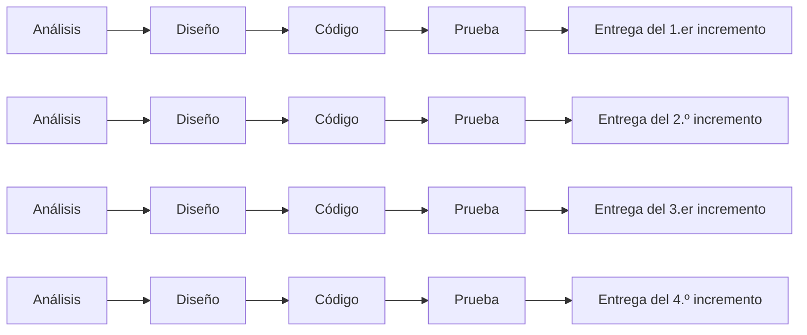

<!-- Reconstrucción Markdown del PDF DNCC-DI-MET-02, Versión 01. Se normalizaron únicamente estructura, saltos de línea y representación de tablas/figuras; el contenido fuente se conserva. -->

# Metodología para el Desarrollo de Software

**Dirección Nacional de CEN CINAI**  
**Versión:** 01  
**Código:** DNCC-DI-MET-02

**Macro proceso:** SISTEMAS INFORMATICOS  
**Proceso:** GESTIÓN DE TI  
**Norma / Instrumento Jurídico:** DECRETO EJECUTIVO No.37270-S, ART 21

## Control documental

| Acción | Rol | Nombre completo | Firma / referencia |
|---|---|---|---|
| Elaborado por | Equipo ad-hoc | Pablo León Porras | Firma digital: 14/03/2022 15:44:19 -06:00 |
| Elaborado por | Equipo ad-hoc | Randy Araya Montero | Firma digital: 14/03/2022 14:29:19 -06:00 |
| Elaborado por | Equipo ad-hoc | Seidy Rodríguez Calderón | Firma digital: 14/03/2022 15:23:15 -06:00 |
| Revisado por | Director de Información | Giovanni León Jiménez | Firma digital: 14/03/2022 14:01:02 -06:00 |
| Revisado por | Planificación Estratégica Institucional | Merceditas Lizano Vega | DNCC-PEI-OF-015-2022. Firma digital: 16/03/2022 13:25:31 -06:00 |
| Aprobado por | Directora Nacional | Lidia María Conejo Morales | Firma digital: 21/03/2022 11:31:29 -06:00 |

**Versión N.º:** 1  
**N.º Oficio:** DNCC-OF-0301-2022 del 11/03/2022

> “Por el crecimiento y desarrollo de nuestras niñas y niños”

**San José, 2022**


## Tabla de Contenido

> La columna “Página” corresponde a la paginación del PDF original.

| Sección | Página |
|---|---:|
| 1. Introducción | 4 |
| 2. Objetivo | 4 |
| 3. Alcance | 4 |
| 4. Sistemas basados en computadoras | 4 |
| 5. Desarrollo de la ingeniería del software | 6 |
| 5.1. El software | 6 |
| 5.2. Características del software | 7 |
| 5.3. ¿Qué es un proyecto de sistemas? | 8 |
| 5.4. La Información | 9 |
| 5.4.1. Almacenamiento de la información | 9 |
| 6. Lenguaje Unificado de Modelado (UML) | 10 |
| 6.1. Breve historial del UML | 10 |
| 6.2. Objetivos de UML | 11 |
| 6.3. Arquitectura del UML | 12 |
| 6.4. Áreas conceptuales de UML | 12 |
| 6.4.1. Estructura estática | 12 |
| 6.4.2. Comportamiento dinámico | 13 |
| 6.4.3. Construcciones de implementación | 13 |
| 6.4.4. Organización del modelo | 13 |
| 6.4.5. Mecanismos de extensión | 13 |
| 7. Aplicación de la metodología de desarrollo de software de la DNCC. | 14 |
| 7.1. Fase de planificación | 16 |
| 7.2. Fase de identificación y análisis de requerimientos | 16 |
| 7.2.1. Desarrollo de la factibilidad técnica | 16 |
| 7.2.2. Viabilidad económica | 17 |
| 7.2.3. Viabilidad legal | 18 |
| 7.2.4. Viabilidad operativa | 18 |
| 7.2.5. Definición y análisis de requerimientos | 19 |
| 7.2.5.1. Revisión de requerimientos del sistema | 20 |
| 7.2.5.2. Aprobación de requerimientos del sistema | 20 |
| 7.2.6. Definición de los requerimientos generales del nuevo sistema | 20 |
| 7.2.6.1. Revisión de requerimientos generales del sistema | 21 |
| 7.2.6.2. Aprobación de requerimientos generales del sistema | 21 |
| 7.2.6.3. Corrección de requerimientos generales del sistema | 21 |
| 7.2.7. Documentación | 22 |
| 7.2.7.1. Presentación de documentación | 22 |
| 7.2.7.2. Revisión y corrección de la documentación | 22 |
| 7.2.7.3. Aprobación de documentación | 22 |
| 7.2.8. Entregable nuevo producto | 22 |
| 7.3. Fase de diseño | 22 |
| 7.3.1. Infraestructura tecnológica propuesta para el nuevo sistema | 23 |
| 7.3.2. Diseño de entradas y salidas para el sistema propuesto | 23 |
| 7.3.3. Diseño del sistema utilizando diagramación UML | 23 |
| 7.3.4. Diseño de base de datos | 23 |
| 7.3.4.1. Estandarización de Base de Datos | 24 |
| a. Nombre de los Objetos que componen la Base de Datos | 25 |
| b. Estructuras de Tablas | 25 |
| c. Nombre de la Base de Datos | 25 |
| d. Nombres de la Tabla | 26 |
| e. Nombre del Campo | 26 |
| f. Tipos de datos usados en los atributos de una tabla | 27 |
| g. Llaves Primarias | 27 |
| h. Llaves Foráneas | 28 |
| i. Relaciones entre Tablas | 28 |
| j. Nombre de Procedimientos Almacenados | 28 |
| k. Nombre de las Vistas | 29 |
| l. Nombre de los Triggers | 29 |
| m. Nombre de Índices | 29 |
| n. Uso de Nulos | 29 |
| 7.3.4.2. Programación en la Base de Datos | 29 |
| a. Códigos Fuentes | 30 |
| b. Nombres | 30 |
| i. Rutinas | 31 |
| ii. Variables | 31 |
| iii. Tablas | 32 |
| iv. Varios | 32 |
| v. Formato | 33 |
| 7.3.4.3. Diccionario de datos | 35 |
| 7.4. Fase de desarrollo | 35 |
| 7.5. Fase de integración y periodo de pruebas | 35 |
| 7.6. Fase de implementación | 36 |
| 7.7. Fase de mantenimiento | 36 |
| 7.7.1. Diseño | 36 |
| 7.7.2. Revisión | 36 |
| 7.7.3. Corrección y aprobación | 37 |
| 7.7.4. Implementación | 37 |
| 8. Anexos | 38 |
| ANEXO 1 | 38 |
| ANEXO 2 | 39 |
| ANEXO 3 | 40 |
| ANEXO 4 | 41 |
| ANEXO 5 | 44 |
| 9. Bibliografía | 45 |

---

## 1. Introducción

La Metodología para el Desarrollo de Software para las Tecnologías de Información y Comunicación (TIC) propuesto en este documento, se elabora con el propósito de orientar a los funcionarios de la Dirección de Información de la Dirección Nacional de CEN-CINAI en la identificación, análisis, desarrollo e implementación para el desarrollo de los sistemas institucionales, estableciendo una manera más ordenada de llevar a cabo los nuevos desarrollos para la institución.

Su elaboración responde además al cumplimiento de lo establecido en las NORMAS TÉCNICAS PARA EL GOBIERNO Y GESTIÓN DE LAS TECNOLOGÍAS DE LA INFORMACIÓN, en lo referente al “ Desarrollo, Implementación y Mantenimiento de Sistemas de Información”; que indica que la unidad de TI debe asegurar la disponibilidad de estándares para programación, gestión de la calidad del software en desarrollo o mantenimiento, cambios por excepción y/o emergencia, llevando un adecuado control de cambios y versiones.

## 2. Objetivo

Administrar adecuadamente los sistemas existentes y los nuevos desarrollos institucionales de TIC mediante el establecimiento de un marco de trabajo donde se defina un modelo, y se estableces can las herramientas necesarias para cada etapa de gestión del Desarrollo, para la Dirección Nacional de CEN-CINAI.

## 3. Alcance

Esta Metodología es aplicable a todas las personas funcionarias de la Dirección de Información, y otros funcionarios que participen en el desarrollo y mantenimiento de aplicaciones para la Dirección Nacional de CEN-CINAI.

## 4. Sistemas basados en computadoras

¿Cuándo un software de computadora se desarrolla con éxito? Cuando satisface las necesidades de las personas que lo utilizan, cuando funciona impecablemente durante mucho tiempo, cuando es fácil de modificar o incluso es más fácil de utilizar, puede cambiar todas las cosas y de hecho las cambia para mejor. Ahora bien, ¿cuándo un software de computadora falla? Cuando los usuarios no se quedan satisfechos, cuando es propenso a errores, cuando es difícil de cambiar e incluso más difícil de utilizar, pueden ocurrir y de hecho ocurren verdaderos desastres. Para tener éxito al diseñar y construir un software se necesita disciplina, respaldada por un enfoque de ingeniería.

Es necesario definir una serie de términos para entender las etapas de desarrollo que conlleva un sistema de información.

La palabra sistema es posiblemente el término más usado y abusado del léxico. Hablamos de sistemas políticos y de sistemas educativos, de sistemas de aviación y de sistemas de fabricación, de sistemas bancarios y de sistemas de locomoción. La palabra no nos dice gran cosa. Usamos el adjetivo para describir el sistema y para entender el contexto en que se emplea. El diccionario Webster-Wikipedia define sistema como:

“1. un conjunto o disposición de cosas relacionadas de manera que forman una unidad o un todo orgánico; 2. Un conjunto de hechos, principios, reglas, etc, clasificadas y dispuestas de manera ordenada mostrando un plan lógico de unión de las partes; 3. Un método o plan de clasificación o disposición; 4.una manera establecida de hacer algo; método; procedimiento…”[^1]

Se proporcionan cinco definiciones más en el diccionario, pero no se sugiere un sinónimo preciso. Sistema es una palabra especial. Tomando prestada la definición del diccionario Webster-Wikipedia, definimos un sistema basado en computadora como:

Un conjunto o disposición de elementos que están organizados para realizar un objetivo predefinido procesando información.

El objetivo puede ser soportar alguna función de negocio o desarrollar un producto que pueda venderse para generar beneficios. Para conseguir el objetivo, un sistema basado en computadora hace uso de varios elementos del sistema:

Software: Programas de computadora, estructuras de datos y su documentación que sirven para hacer efectivo el método lógico, procedimiento o control requerido.

Hardware: Dispositivo electrónico que proporcionan capacidad de cálculo, dispositivos de interconexión (por ejemplo, conmutadores de red, dispositivos de telecomunicaciones) y dispositivos electromecánicos (por ejemplo, sensores, motores, bombas) que proporcionan una función externa, del mundo real.

Personas: Usuarios y operadores del hardware y software.

Documentación: Manuales, formularios y otra información descrita que plasma el empleo y/o funcionamiento del sistema.

Procedimientos: Los pasos que definen el empleo específico de cada elemento del sistema o el contexto procedimental en que reside el sistema.

Una característica complicada de los sistemas basados en computadoras es que los elementos que componen un sistema pueden también representar un macroelemento de un sistema aún más grande. El macroelemento es un sistema basado en computadoras que es parte de un sistema más grande basado en computadoras.

El papel del ingeniero de sistemas es definir los elementos de un sistema basado en computadora en el contexto de la jerarquía global de sistemas.

## 5. Desarrollo de la ingeniería del software

Aunque cientos de autores han desarrollado definiciones personales de la ingeniería del software, una definición propuesta por Fritz Bauer [NAU69], en una conferencia de gran influencia sobre estos temas va a servir como base de estudio:

“[La Ingeniería del Software] es el establecimiento y uso de principios robustos de la ingeniería a fin de obtener económicamente software que sea fiable y que funcione eficientemente sobre máquinas reales.”

El IEEE ha desarrollado una definición más completa:

Ingeniería del Software: (1) La aplicación de un enfoque sistemático, disciplinado y cuantificable hacia el desarrollo, operación y mantenimiento del software; es decir, la aplicación de ingeniería al software.[^2]

Con las definiciones antes descritas podemos definir con nuestras palabras que la ingeniería del software es una disciplina o área de la informática que ofrece métodos y técnicas para desarrollar y mantener software de calidad que resuelve problemas de diferentes tipos.

Esta ingeniaría aborda las diferentes fases del ciclo de vida del desarrollo de cualquier tipo de sistemas de información, que son aplicables a una infinidad de áreas, tales como: negocios, investigación científica, medicina, producción, banca, Internet, Intranet, entre otros.

### 5.1. El software

Hoy en día el software tiene un doble papel. Es un producto y al mismo tiempo, el vehículo para entregarlo. Como producto, hace entrega de la potencia informática que incorpora el hardware informático o, más ampliamente, una red de computadora que es accesible por hardware local. Si reside dentro de un teléfono celular u opera dentro de una computadora central, el software es un transformador de información, produciendo, gestionando, adquiriendo, modificando, mostrando o transmitiendo información que puede ser tan simple como un solo bit, o tan complejo como una presentación en multimedia. Como vehículo utilizado para hacer entrega del producto, el software actúa como la base de control de la computadora (sistemas operativos), la comunicación de información (redes) y la creación y control de otros programas (herramientas de software y entornos).

El papel del software informático ha sufrido un cambio significativo durante un periodo de tiempo superior a 50 años. Enormes mejoras en rendimiento del hardware, profundos cambios de arquitectura informática, grandes aumentos de memoria y capacidad de almacenamiento y una gran variedad de opciones de entrada y salida han conducido a sistemas más sofisticados y más complejos basados en computadora. La sofisticación y la complejidad pueden producir resultados deslumbrantes cuando un sistema tiene éxito, pero también puede suponer grandes problemas para aquellos que deben construir sistemas complejos.

### 5.2. Características del software

Para poder comprender lo que es el software (y consecuentemente la ingeniería del software), es importante examinar las características del software que lo diferencian de otras cosas que los hombres pueden construir. Cuando se construye hardware el proceso creativo humano (análisis, diseño, construcción, prueba) se traduce finalmente en una forma física. Si construimos una nueva computadora, nuestro boceto inicial, diagramas formales de diseño y prototipos de prueba, evolucionan hacia un producto físico (chips, tarjetas de circuitos impresos, fuentes de potencia, entre otros).

El software es un elemento del sistema que es lógico, en lugar de físico. Por tanto el software tiene unas características considerablemente distintas a las del hardware:

- a. El software se desarrolla, no se fabrica en un sentido clásico. Aunque en ambas actividades la buena calidad se adquiere mediante un buen diseño, en la fase de construcción del hardware pueden introducirse problemas de calidad que no existen (o son fácilmente corregibles) en el software. Ambas actividades dependen de las personas, pero la relación entre las personas dedicadas y el trabajo realizado es completamente diferente para el software.

Los costos del software se encuentran en la ingeniería. Esto significa que los proyectos de software no se pueden gestionar como si fueran proyectos de fabricación.

- b. El software no se “estropea” El software no es susceptible a los males del entorno que hacen que el hardware se estropee. Cuando un componente de hardware se estropea se sustituye por una pieza de repuesto. No hay pieza de repuesto para el software. Cada fallo en él indica un error en el diseño, o en el proceso mediante el cual se tradujo el diseño en código-máquina ejecutable. Por lo tanto, el mantenimiento del software tiene una complejidad considerablemente mayor que la del mantenimiento del hardware. Si embargo la implicación es clara, el software no se estropea. ¡Pero se deteriora!

### 5.3. ¿Qué es un proyecto de sistemas?

Para gestionar un proyecto de software con éxito, debemos comprender qué puede ir mal y cómo hacerlo bien. Sobre proyectos de software, John Reel (REE99) define diez señales que indican que un proyecto de sistemas de información está en peligro, ellas son:

1. La gente del software no comprende las necesidades de los clientes.
2. El ámbito del producto está definido pobremente.
3. Los cambios están mal realizados.
4. Las necesidades del negocio cambian o están mal definidas.
5. La tecnología elegida cambia.
6. Las fechas de entrega no son reales.
7. Los usuarios se resisten.
8. Se pierden los patrocinadores (o nunca se obtuvieron adecuadamente).
9. El equipo el proyecto carece del personal con las habilidades apropiadas.
10. Los gestores (y los desarrolladores) evitan buenas prácticas y sabias lecciones.

¿Cómo actúa un gestor para evitar los problemas señalados anteriormente? Reel (REE99) sugiere una aproximación de sentido común a los proyectos de software dividido en cinco partes:

- a. Empezar con el pie derecho.
- b. Mantenerse.
- c. Seguimiento del Progreso.
- d. Tomar decisiones Inteligentes.
- e. Realizar un análisis “Postmortem” (después de finalizar el proyecto).

Un proyecto ofrece beneficios si:

- a. Resuelve un problema empresarial.
- b. Permite aprovechar una oportunidad.

Los beneficios se pueden clasificar en:

- a. Incremento en los ingresos.
- b. Reducción de los costos.
- c. Mejoría en los servicios al cliente.
- d. Logro de una diferencia de mercado para un producto o servicio.
- e. Dar un valor agregado a un producto o servicio.
- f. Cumplir con un requisito comercial.

### 5.4. La Información

(LUI03) Dentro de las organizaciones la información se ha convertido en un recurso principal. Los tomadores de decisiones han comprendido que la información no es sólo un subproceso de la conducción, sino que, a la vez alimenta a los negocios y puede ser el factor clave para la determinación del éxito o el fracaso de éstos.

Para maximizar la utilidad de la información una empresa debe manejarla correctamente, tal como maneja los demás recursos. Los administradores necesitan comprender que hay costos relacionados con la producción, la distribución, la seguridad, el almacenamiento y la recuperación de toda información.

#### 5.4.1. Almacenamiento de la información

Las bases de datos hoy en día ocupan un lugar determinante en cualquier área del quehacer humano, comercial y tecnológico. No sólo las persona que están involucradas en el área de la información sino todas las del área administrativa, técnica y, con mayor razón, los profesionales de cualquier carrera, que deben tener los conocimientos necesarios para poder usar las bases de datos.

Para poder usar las bases de datos se deben conocer una herramienta que permita almacenar y consultar información. Estas herramientas son llamadas sistemas manejadores de bases de datos, sus siglas inglés son DBMS (Database Management System).

La información almacenada facilita la toma de decisiones en lo que respecta a la personalización de los productos y servicios para atraer, retener y profundizar las relaciones con los diferentes clientes, según el nivel de rentabilidad de cada uno de ellos.

Esta información se encuentra en una base de datos que permite contar con una herramienta para el análisis y la planeación de mercadotecnia, identificación de prospectos, entrega de información y obtención de clientes. Esta base de datos, que contiene la información necesaria para implementar un modelo en una empresa, permite que todos los departamentos estén interconectados entre sí, lo que facilita el acceso a la información sobre el cliente a todos aquellos que entran en contacto con él.

Las bases de datos permiten que la información se encuentre disponible para todos los empleados en diferentes puntos.

Las bases de datos representan “un activo intangible muy importante” para la empresa. A pesar de esto, cabe mencionar que la base de datos es sólo una herramienta. Los administradores y los analistas de las empresas deben recuperar los datos de la base de datos para convertirlos en información, y esto dará forma a los cimientos para una base que permita una mejor toma de decisiones.

Las bases de datos contienen las diferentes variantes, pronósticos, descubrimientos de relaciones, secuencias, reconocimientos de patrones, entre otros, con la finalidad de convertirlas en conocimientos. Un punto importante de las bases de datos es poder tener a la mano toda la información que sea útil en el momento oportuno.

## 6. Lenguaje Unificado de Modelado (UML)

Dado que el llamado UML nos permite modelar un diseño preliminar de un sistema de información, hemos tomado esta herramienta para diseñar el esqueleto de nuestros sistemas en la Dirección Nacional de CEN CINAI (en adelante DNCC), para tal efecto hemos consultado una serie de citas bibliográficas, que nos permite tener un conocimiento más amplio de este lenguaje, para tal efecto hemos consultado el libro “El Proceso Unificado de Desarrollo del Software” de los autores Ivar Jacobson, Grady Booch y James Rumbaugh. En los siguientes puntos se extrae del mismo una serie de información de esta herramienta.

[INT1] Es un lenguaje de modelado visual que se usa para especificar, visualizar, construir y documentar artefactos de un sistema de software. Se usa para entender, diseñar, configurar, mantener y controlar la información sobre los sistemas a construir. UML capta la información sobre la estructura estática y el comportamiento dinámico de un sistema. Un sistema se modela como una colección de objetos discretos que interactúan para realizar un trabajo que finalmente beneficia a un usuario externo.

El lenguaje de modelado pretende unificar la experiencia pasada sobre técnicas de modelado e incorporar las mejores prácticas actuales en un acercamiento estándar. UML no es un lenguaje de programación. Las herramientas pueden ofrecer generadores de código de UML para una gran variedad de lenguaje de programación, así como construir modelos por ingeniería inversa a partir de programas existentes.

Es un lenguaje de propósito general para el modelado orientado a objetos. UML es también un lenguaje de modelamiento visual que permite una abstracción del sistema y sus componentes.

Existían diversos métodos y técnicas Orientadas a Objetos, con muchos aspectos en común, pero utilizando distintas notaciones, se presentaban inconvenientes para el aprendizaje, aplicación, construcción y uso de herramientas, etc., además de pugnas entre enfoques, lo que generó la creación del UML como estándar para el modelamiento de sistemas de software principalmente, pero con posibilidades de ser aplicado a todo tipo de proyectos.

### 6.1. Breve historial del UML

[INT2] La notación UML se deriva y unifica las tres metodologías de análisis y diseños más extendidas:

- a. Metodología de Grady Booch para la descripción de conjuntos de objetos y sus relaciones.
- b. Técnica de modelado orientada a objetos de James Rumbaugh (OMT: Object-Modeling Technique / Técnica de modelado de objetos).

- c. Aproximación de Ivar Jacobson (OOSE: Object- Oriented Software Engineering / Ingeniería del Software orientada a objetos) mediante la metodología de casos de uso (use case).

El desarrollo de UML comenzó a finales de 1994 cuando Grady Booch y Jim Rumbaugh de Rational Software Corporation empezaron a unificar sus métodos. A finales de 1995, Ivar Jacobson y su compañía Objectory se incorporaron a Rational en su unificación, aportando el método OOSE.

De las tres metodologías de partida, las de Booch y Rumbaugh pueden ser descritas como centradas en objetos, ya que sus aproximaciones se enfocan hacia el modelado de los objetos que componen el sistema, su relación y colaboración. Por otro lado, la metodología de Jacobson es más centrada a usuario, ya que todo en su método se deriva de los escenarios de uso. UML se ha ido fomentando y aceptando como estándar desde la formación de OMG, que es también el origen de CORBA, el estándar líder en la industria para la programación de objetos distribuidos. En 1997 UML 1.1 fue aprobada por la OMG convirtiéndose en la notación estándar de facto para el análisis y el diseño orientado a objetos.

UML es el primer método en publicar un meta-modelo en su propia notación, incluyendo la notación para la mayoría de la información de requisitos, análisis y diseño. Se trata pues de un meta-modelo auto-referencial (cualquier lenguaje de modelado de propósito general debería ser capaz de modelarse a sí mismo).

### 6.2. Objetivos de UML

Durante el desarrollo del UML sus autores tuvieron en cuenta:

- a. Proporcionar una notación y semánticas suficientes para poder alcanzar una gran cantidad de aspectos del modelado contemporáneo de una forma directa y económica.
- b. Proporcionar las semánticas suficientes para alcanzar aspectos del modelado que son de esperar en un futuro, como por ejemplo aspectos relacionados con la tecnología de componentes, el cómputo distribuido y otros.
- c. Proporcionar mecanismos de extensión de forma que proyectos concretos puedan extender el meta- modelo a un costo bajo.
- d. Proporcionar mecanismos de extensión de forma que aproximaciones de modelado futuras podrían desarrollarse encima del UML.
- e. Permitir el intercambio del modelo entre una gran variedad de herramientas.
- f. Proporcionar semánticas suficientes para especificar las interfaces a bibliotecas para la distribución y el almacenamiento de componentes del modelo.

Mediante el fomento del uso de UML OMG pretende alcanzar los siguientes objetivos:

- a. Proporcionar a los usuarios un lenguaje de modelado visual expresivo y utilizable para el desarrollo e intercambio de modelos significativos.

- b. Proporcionar mecanismos de extensión y especialización.
- c. Ser independiente del proceso de desarrollo y de los lenguajes de programación.
- d. Proporcionar una base formal para entender el lenguaje de modelado.
- e. Fomentar el crecimiento del mercado de las herramientas OO.
- f. Soportar conceptos de desarrollo de alto nivel como pueden ser colaboraciones, frameworks, patterns, y componentes.
- g. Integrar las mejores prácticas utilizadas hasta el momento.

El UML debe entenderse como un estándar para modelado y no como un estándar de proceso software. Aunque UML debe ser aplicado en el contexto de un proceso, la experiencia ha mostrado que organizaciones heterogéneas requieren diferentes procesos. Por ello se han centrado los esfuerzos en un meta-modelo común (que unifica las semánticas) y una notación común que proporcione una representación de esas semánticas. De todas formas, los autores de UML fomentan un proceso guiado por casos de uso, centrado en la arquitectura, iterativo e incremental.

Bajo estas líneas genéricas proponen el proceso – software, definido, en una de las extensiones del UML (Objectory Extension for Software Enginnering), pero en general el proceso - software es fuertemente dependiente de la organización y del dominio de aplicación.

Por último, mencionar que aunque UML abarca todas las técnicas existentes, es de esperar que aparezcan nuevas técnicas. El UML se puede adaptar a estas nuevas técnicas ya que dispone de mecanismos de extensión que no necesitan redefinir el núcleo UML.

### 6.3. Arquitectura del UML

Arquitectura de cuatro capas, definida a fin de cumplir con la especificación Meta Object Facility del OMG:

- a. Meta-metamodelo: define el lenguaje para especificar metamodelos.
- b. Metamodelo: define el lenguaje para especificar modelos.
- c. Modelo: define el lenguaje para describir un dominio de información.
- d. Objetos de usuario: define un dominio de información específico.

### 6.4. Áreas conceptuales de UML

Los conceptos y modelos de UML pueden agruparse en las siguientes áreas conceptuales:

#### 6.4.1. Estructura estática

Cualquier modelo preciso debe primero definir su universo, esto es, los conceptos clave de la aplicación, sus propiedades internas, y las relaciones entre cada una de ellas. Este conjunto de construcciones es la estructura estática. Los conceptos de la aplicación son modelados como clases, cada una de las cuales describe un conjunto de objetos que almacenan información y se comunican para implementar un comportamiento. La información que almacena es modelada como atributos; La estructura estática se expresa con diagramas de clases y puede usarse para generar la mayoría de las declaraciones de estructuras de datos en un programa.

#### 6.4.2. Comportamiento dinámico

Hay dos formas de modelar el comportamiento, una es la historia de la vida de un objeto y la forma como interactúa con el resto del mundo y la otra es por los patrones de comunicación de un conjunto de objetos conectados, es decir la forma en que interactúan entre sí. La visión de un objeto aislado es una máquina de estados, muestra la forma en que el objeto responde a los eventos en función de su estado actual. La visión de la interacción de los objetos se representa con los enlaces entre objetos junto con el flujo de mensajes y los enlaces entre ellos. Este punto de vista unifica la estructura de los datos, el control de flujo y el flujo de datos.

#### 6.4.3. Construcciones de implementación

Los modelos UML tienen significado para el análisis lógico y para la implementación física. Un componente es una parte física reemplazable de un sistema y es capaz de responder a las peticiones descritas por un conjunto de interfaces. Un nodo es un recurso computacional que define una localización durante la ejecución de un sistema. Puede contener componentes y objetos.

#### 6.4.4. Organización del modelo

La información del modelo debe ser dividida en piezas coherentes, para que los equipos puedan trabajar en las diferentes partes de forma concurrente. El conocimiento humano requiere que se organice el contenido del modelo en paquetes de tamaño modesto. Los paquetes son unidades organizativas, jerárquicas y de propósito general de los modelos de UML. Pueden usarse para almacenamiento, control de acceso, gestión de la configuración y construcción de bibliotecas que contengan fragmentos de código reutilizable.

#### 6.4.5. Mecanismos de extensión

UML tiene una limitada capacidad de extensión pero que es suficiente para la mayoría de las extensiones que requiere día a día sin la necesidad de un cambio en el lenguaje básico. Un estereotipo es una nueva clase de elemento de modelado con la misma estructura que un elemento existente, pero con restricciones adicionales.

## 7. Aplicación de la metodología de desarrollo de software de la DNCC.

Vamos a dividir los proyectos de información en siete faces de desarrollo que permitirán el análisis, desarrollo e implementación de un sistema de información en la DNCC. Estas fases de desarrollo utilizaran la Metodología de desarrollo llamada Modelo Incremental.

Se reconoce que el software, al igual que todos los sistemas complejos, evoluciona con el tiempo [GIL88]. Los requisitos de gestión y de productos a menudo cambian conforme a que el desarrollo proceda, haciendo que el camino que lleva al producto final no sea real; las estrictas fechas tope del mercado hacen que sea imposible finalizar un producto completo, por lo que se debe introducir una versión limitada para cumplir la presión competitiva y de gestión; se comprende perfectamente el conjunto de requisitos de productos centrales o del sistema, pero todavía se tienen que definir los detalles de extensiones del producto o sistema. En estas y en otras situaciones similares, los ingenieros del software necesitan un modelo de proceso que se ha diseñado explícitamente para acomodarse a un producto que evolucione con el tiempo.

El modelo lineal secuencial se diseña para el desarrollo en línea recta. En esencia, este enfoque en cascada asume que se va entregar un sistema completo una vez que la secuencia lineal se haya finalizado. El modelo de construcción de prototipos se diseña para ayudar al cliente (o al que desarrolla) a comprender los requisitos. En general, no se diseña para entregar un sistema de producción. En ninguno de los paradigmas de ingeniería del software se tiene en cuenta la naturaleza evolutiva del software. Los modelos evolutivos son iterativos. Se caracterizan por la forma en que permiten a los ingenieros del software desarrollar versiones cada vez más completas del software.

Es por eso que hemos decidido utilizar el Modelo Incremental para el desarrollo de nuestras aplicaciones informáticas. El modelo incremental combina elementos del modelo lineal secuencial (aplicados repetidamente) con la filosofía interactiva de construcción de prototipos. Tal y como se muestra en la siguiente figura y como se explica en los siguientes párrafos:

**Figura 1. Modelo Incremental**



*Fuente: [ROG02] Roger S. Pressman (2002). Ingeniería del Software, un enfoque práctico. México: McGraw-Hill, Quinta Edición.*

El modelo incremental aplica secuencias lineales de forma escalonada mientras progresa el tiempo en el calendario. Cada secuencia lineal produce un «incremento» del software. Por ejemplo, el software de tratamiento de textos desarrollado con el paradigma incremental podría extraer funciones de gestión de archivos básicos y de producción de documentos en el primer incremento; funciones de edición más sofisticadas y de producción de documentos en el segundo incremento; corrección ortográfica y gramatical en el tercero; y una función avanzada de esquema de página en el cuarto. Se debería tener en cuenta que el flujo del proceso de cualquier incremento puede incorporar el paradigma de construcción de prototipos.

Cuando se utiliza un modelo incremental, el primer incremento a menudo es un producto esencial. Es decir, se afrontan requisitos básicos, pero muchas funciones suplementarias (algunas conocidas, otras no) quedan sin extraer. El cliente utiliza el producto central (o sufre la revisión detallada). Como un resultado de utilización y/o de evaluación, se desarrolla un plan para el incremento siguiente. El plan afronta la modificación del producto central a fin de cumplir mejor las necesidades del cliente y la entrega de funciones, y características adicionales. Este proceso se repite siguiendo la entrega de cada incremento, hasta que se elabore el producto completo.

El modelo de proceso incremental, como la construcción de prototipos y otros enfoques evolutivos, es iterativo por naturaleza. Pero a diferencia de la construcción de prototipos, el modelo incremental se centra en la entrega de un producto operacional con cada incremento. Los primeros incrementos son versiones «incompletas» del producto final, pero proporcionan al usuario la funcionalidad que precisa y también una plataforma para la evaluación. El desarrollo incremental es particularmente útil cuando la dotación de personal no está disponible para una implementación completa en la fecha límite que se haya establecido para el proyecto. Los primeros incrementos se pueden implementar con menos personas.

### 7.1. Fase de planificación

Es necesario definir ¿qué es el proyecto?, ¿quiénes son los actores, patrocinadores, alcance del proyecto, justificación, antecedentes, entre otros? También es preciso asociar las diferentes actividades a plazos de tiempo y designar roles y responsabilidades. Para estos efectos se debe completar el documento Acta Constitutiva del Proyecto (Anexo 4).

Para esta etapa se debe considerar lo establecido en el documento de Metodología para la Implementación de Proyectos de Tecnologías de Información y Comunicación, Código DNCC-DI-MET-01.

### 7.2. Fase de identificación y análisis de requerimientos

Esta fase tiene que ver con el análisis y busca concretar una serie de requisitos, que son los que regirán el nuevo sistema o los cambios a introducir en el antiguo, si con el proyecto se busca su actualización.

La misma tendrá las siguientes sub fases por desarrollar:

#### 7.2.1. Desarrollo de la factibilidad técnica

El analista debe averiguar si es posible actualizar o incrementar los recursos técnicos actuales de tal manera que satisfagan los requerimientos. Esta actividad se debe llevar a cabo por medio de visitas de campo donde se encuentra ubicado el patrocinador del proyecto, por medio de entrevistas y observaciones rigurosas a cada actividad que estos desempeñan, de tal manera que se puede obtener una visión más global del proyecto. Para estos efectos de deben generar los documentos que evidencien las actividades llevadas a cabo por parte del analista de la UTIC.

Estas visitas se pueden efectuar en un máximo de 5 días completos, basándose en los requerimientos discutidos y establecidos con los usuarios del sistema, se debe dedicar una gran parte del tiempo, con el fin de determinar si los requerimientos preliminares podrían ser desarrollados desde el punto de vista técnico. Para esto se deben realizar las siguientes valoraciones:

- a. Herramientas de desarrollo Para estos efectos la UTIC se apoyará de las licencias con las que cuente la DNCC en su momento, para el uso de las herramientas de programación, base de datos, reportería, minería de datos, inteligencia de negocios, entre otras.

Si se determina que no se puede llevar a cabo el desarrollo utilizando las herramientas con las que cuenta la institución, se realizará un análisis de ¿cuáles son las herramientas y técnicas requeridas para realizar el nuevo desarrollo?, considerando los elementos mencionados anteriormente.

- b. Grado de complejidad de los algoritmos Para realizar los reportes requeridos se tiene que llevar a cabo el levantado de requerimientos con los usuarios expertos, realizando el llenado de cuestionarios, entrevistas, ejemplos de reportes en Excel, dibujo a mano alzada de lo requerido; esto con el objetivo de que el analista de la DI tenga una idea más acertada de lo requerido por el usuario para ser posteriormente llevado a cabo en la fase de desarrollo.

En el caso de posibles procesos financieros-contables y cálculos matemáticos, de manera conjunta entre el analista de sistemas y el usuario experto, se debe determinar las variables medulares a considerar; lo cual generará un documento que debe estar firmado por el usuario experto, la jefatura del área para la cual se desarrolla, el analista de sistemas y el jefe de la UTIC, para dar por establecidas y aprobadas las variables.

- c. Capacidad de la infraestructura técnica del lugar Es necesario validar la necesidad de contar con redes, internet, oficinas, ventilación, equipo de cómputo, servidores. Para estos efectos se debe realizar la consulta a la UTIC, sobre la disponibilidad de estos recursos para poder llevar a cabo el nuevo desarrollo. Caso contrario se informará sobre la no capacidad y las medidas a realizar para poder contar con los recursos requeridos.

- d. Inversión de los recursos necesarios para la ejecución del proyecto. De igual manera es necesario validar la necesidad de insumos como papel, impresoras, tóner, cartuchos, discos compactos, medios de almacenamiento USB, personal adicional, personal técnico de campo. Se debe contar con la solicitud de inclusión de presupuesto a la UTIC en el anteproyecto de presupuesto de Ley de la DI.

#### 7.2.2. Viabilidad económica

Los recursos básicos que se deben considerar son: El costo estimado del hardware y el costo estimado del software comercial o del desarrollo de software. El costo del tiempo de los empleados actores de la DNCC. El costo de realizar un estudio de sistemas completo (incluyendo el tiempo de los empleados con los que se trabajará). El tiempo del equipo de análisis de sistemas.

Se deben entregar los documentos y proformas en caso de ser requeridas para la estimación inicial de los costos del proyecto, antes de que sean trasladados a la UTIC para su análisis. Una vez realizado el análisis inicial por parte de la UTIC se debe aplicar lo indicado en la Metodología de Proyectos.

La viabilidad económica está íntimamente relacionada con el presupuesto que se establece para el proyecto. Una vez aprobado el anteproyecto de ley y se incluyó el presupuesto requerido, se puede concluir que el proyecto es económicamente factible.

#### 7.2.3. Viabilidad legal

Contar con las licencias de desarrollo, sistemas operativos, base de datos, convenios con instituciones externar para recibir y enviar datos críticos y oportunos. Tomar en cuenta si la DNCC desea registrar y obtener derechos intelectuales del programa desarrollado.

Para estos efectos se tienen que generar las consultas de manera formal al área a cargo de esta labor en donde se remita un inventario de la cantidad y tipo de licencias o equipos requeridos para el desarrollo del nuevo sistema, para que con este insumo la UTIC determine si se cuenta con los insumos requeridos o se deben realizar otras acciones.

El analista a cargo debe realizar con detalle un levantado de requerimientos con las posibles interacciones que se tengan con otras instituciones y la información que se deba trasladar o las aplicaciones o servicios que se deban compartir, considerando las medidas de seguridad requeridas para garantizar la integridad de la información; este detalle será incorporado en el nuevo desarrollo como un requerimiento más.

Una vez que se tenga el listado con los equipos, licencias, enlaces disponibles y posibles interacciones con otras instituciones se podrá evidenciar de esta manera que cuentan con todos los requerimientos requeridos para llevar a cabo el proyecto, garantizando de esta manera que no se están realizando el uso de software o servicios para los cuales no se tiene las licencias o permisos respectivos.

#### 7.2.4. Viabilidad operativa

La viabilidad operativa depende de los recursos humanos y tecnológicos con los que se dispone para el proyecto e implica determinar si el sistema funcionará (ambiente de pruebas, desarrollo y producción) y será utilizado una vez que se instale.

Hay más probabilidades de que a la larga el sistema solicitado sea utilizado si los mismos usuarios han expresado la necesidad de un sistema que funcione la mayor parte del tiempo, de una manera más eficiente y accesible, a que si, por el contrario, los usuarios están contentos con el sistema actual, no tienen problemas con su manejo y por lo general no están involucrados en la solicitud de un nuevo sistema.

El analista de la UTIC, deberá entregar un documento en el cual se consideran todos los insumos requeridos para llevar a cabo el nuevo desarrollo, evidenciando en este documento el personal mínimo requerido de las unidades que deban participar a lo largo del proceso, los insumos y variables requeridos para el nuevo desarrollo.

#### 7.2.5. Definición y análisis de requerimientos

Para cumplir con cada uno de los objetivos definidos para el proyecto, es necesario efectuar varias sesiones de trabajo con el personal que conforma la Dirección o Unidad donde se llevará a cabo el proyecto. Producto de esta investigación se deberá lograr obtener una lista detallada de los requerimientos generales y específicos para el nuevo Sistema Informático.

Para lograr un análisis de requerimientos que se ajuste a las expectativas del sistema, se deben utilizar diversas técnicas como:

- a. CUESTIONARIOS: Desarrollar cuestionarios cortos y preferiblemente con preguntas que no sea tipo análisis y desarrollo, ya que puede ocasionar un descaste y desinterés del usuario por llenarlos. Puede incluir preguntas cerradas con opciones de respuesta ya prestablecidas.

- b. ENTREVISTAS: Es necesario pensar detalladamente en las entrevistas antes de hacerlas. ¿Visualizar por qué las va a hacer? Qué va a preguntar y qué es lo que a su juicio hará que esta entrevista tenga éxito. Asimismo, se deberá pensar cómo logrará que la entrevista sea satisfactoria para el usuario al que entreviste. Busque las opiniones de la persona que entreviste. Las opiniones podrían ser más importantes y reveladoras que los hechos. Es necesario tener presente los siguientes 5 puntos para desarrollar una entrevista:

1. Decidir el tipo de preguntas y la estructura.
2. Preparar al entrevistado.
3. Decidir a quién entrevistar.
4. Establecer los objetivos de la entrevista.
5. Leer los antecedentes.

- c. EXPERIENCIAS DE TRABAJO: Muchas veces es mejor entrevistar a las personas que están en la línea de fuego, ya que ellas son las que más saben de los procesos, se relacionan más con el quehacer cotidiano del proceso. No solo se debe quedar con la información de los directores o jefes, es necesario también buscar la experiencia de las personas operativas.

- d. REVISIÓN DE DOCUMENTOS: Recopilar todo documento que se utilice en el proceso y custodiarlo en un portafolio de evidencia para documentar el proceso que se hace físicamente.

- e. ANÁLISIS DE CASOS: Determinar cuáles procesos son más críticos y complicados para realizar un análisis más exhaustivo y determinar todos los posibles escenarios que se puedan dar.

- f. MÉTODO CIENTÍFICO DE OBSERVACIÓN: Observar detalladamente todos los procesos que los usuarios hacen sin intervenir en ellos, actividad que se llevará a cabo durante las visitas programadas.

Toda la documentación generada en los ítems anteriores se debe incorporar por parte del analista de la UTIC al expediente (físico-digital) del nuevo desarrollo para efectos de documentar y tabular la información obtenida en la estructura definida por la UTIC para estos efectos.

##### 7.2.5.1. Revisión de requerimientos del sistema

Se deben realizar un inventario con los requerimientos previos a la instalación o puesta en marcha del nuevo desarrollo, como lo son cantidad y tipo de licencias requeridas, servidores (cantidad de servidores) almacenamiento (estimados de almacenamiento iniciales) y enlaces de comunicación (anchos de banda mínimos requeridos), construcción y creación de posibles ambientes de desarrollo, pruebas y producción.

Se deben realizar pruebas de funcionamiento de la infraestructura física como servidores de procesamiento, unidades de almacenamiento, enlaces de comunicación y bases de datos creadas acorde a lo establecido en los requerimientos y mejores prácticas establecidas por la UTIC.

Se debe verificar que los ambientes de pruebas, desarrollo y producción se encuentren funcionando de manera adecuada antes de iniciar las labores propias en cada entorno.

##### 7.2.5.2. Aprobación de requerimientos del sistema

Se debe generar un documento en donde se indiquen los tipos de pruebas que se realizaron a la infraestructura, tanto de servidores, base de datos e infraestructura de comunicación. Este informe debe indicar la persona que realiza las pruebas y la persona que supervisa que todo se lleve a cabo de una manera adecuada, de esta forma se pueden dar por aprobados los requerimientos operativos para el entorno de desarrollo.

En caso de que las pruebas realizadas indiquen que no se cumple con lo establecido se deben realizar los ajustes necesarios para cumplir con lo requerido.

#### 7.2.6. Definición de los requerimientos generales del nuevo sistema

Una vez liberada la primera versión de los sistemas, se procede con el análisis de los nuevos procesos y requerimientos que no se consideraron en la fase inicial de la versión previamente liberada, se debe proceder con el análisis de los registros de libros electrónicos en Excel, formularios, libros contables, libros legales, auditoria y otra documentación, se deben determinar los siguientes requerimientos generales, fundamentales para el desarrollo e implementación de cualquier sistema de información a desarrolla:

- a. El sistema debe ser desarrollado en una plataforma tecnológica que garantice la disponibilidad, confidencialidad, integridad y acceso a la información y poder de crecimiento.
- b. El sistema debe ser multiusuario pero seguro, para ello es importante establecer controles por medio de la definición de privilegios de acceso para cada usuario, de acuerdo a sus funciones.
- c. Todas las estaciones de trabajo de los usuarios del sistema deberán ser incorporadas a la red institucional para que tengan acceso al sistema, en caso de que sean aplicaciones Cliente/Servidor, en caso de sistemas Web deberán ser federadas en los privilegios de acceso.
- d. La base de datos, deben estar alojados en el servidor de producción de base de datos, los archivos ejecutables e instalables deberán estar en una dirección de archivos UTILITARIOS para un fácil acceso.
- e. El sistema debe contar con los Manuales técnico, de usuario y de base de datos, como mínimo (Anexo # 5).
- f. El sistema debe ser diseñado e implantado utilizando una herramienta de desarrollo gráfico preferiblemente la plataforma WEB, que le permita al usuario explotar las características de flexibilidad, agilidad, versatilidad y amigabilidad, entre otros.

##### 7.2.6.1. Revisión de requerimientos generales del sistema

Se debe realizar la revisión de los elementos establecidos en el punto 7.2.8 Definición de los Requerimientos Generales del nuevo sistema por parte del analista de la UTIC, los cuales se deben encontrar de manera completa e incorporada en la documentación del nuevo sistema.

##### 7.2.6.2. Aprobación de requerimientos generales del sistema

Una vez realizada la revisión indicada en el punto anterior se debe generar un documento en donde se indique que se dan por aprobados los requerimientos Generales del Sistema revisados. Este informe debe indicar la persona que realizó las pruebas y quien supervisa que todo se lleve a cabo de una manera adecuada y se puedan dar por aprobados los requerimientos generales del sistema.

##### 7.2.6.3. Corrección de requerimientos generales del sistema

En caso de que las pruebas realizadas indiquen que no se cumple con lo establecido en el punto 7.2.8 Definición de los Requerimientos Generales del nuevo sistema se deben realizar los ajustes requeridos para cumplir con lo establecido.

Si no es posible cumplir con lo requerido se deben informar a las partes interesadas sobre el incumplimiento y las posibles acciones a realizar para lograr el cumplimiento de los objetivos de los requerimientos generales del Sistema establecidos y que garanticen su buen funcionamiento. Para estos efectos se deben modificar los requerimientos iniciales establecidos utilizando los mecanismos para estas actividades.

#### 7.2.7. Documentación

Se debe realizar una reunión de manera conjunta con todos los actores del nuevo desarrollo o incremento del modelo actual para definir el alcance, así como toda la documentación relacionada con el inicio y ejecución del nuevo desarrollo.

##### 7.2.7.1. Presentación de documentación

Se deben entregar los documentos obtenidos en el apartado 7.2.5. Definición y Análisis de Requerimientos al analista de la UTIC, para tomarlos como punto de partida para ser consideradas al momento de desarrollar los nuevos requerimientos por parte del analista de la UTIC, este debido a que en los documentos iniciales se consideran las reglas del negocio y principales macro procesos, sobre los cuales se deben realizar las nuevas acciones.

##### 7.2.7.2. Revisión y corrección de la documentación

El analista de la UTIC debe realizar las acciones pertinentes para validar que toda la documentación se encuentra acorde a lo establecido. En caso contrario debe proceder a devolver la información a la contra parte correspondiente para que se realicen los ajustes correspondientes y se traslade nuevamente la documentación para su debida revisión. En caso de ser aprobada se debe continuar con lo establecido en el punto 7.2.14 Aprobación Fase Análisis de documentación.

##### 7.2.7.3. Aprobación de documentación

Una vez revisados los documentos se debe proceder por parte de la UTIC a realizar la aceptación de los nuevos requerimientos por parte de la unidad solicitante. El analista de la UTIC puede proceder con el desarrollo de los requerimientos aprobados.

#### 7.2.8. Entregable nuevo producto

Una vez que se cumpla con lo requerido en el punto anterior, se debe realizar una propuesta a la contraparte, con la estimación de duración para llevar a cabo el desarrollo e implementación de los requerimientos aprobados, para lo cual el analista de la UTIC debe considerar todos los elementos establecidos en el punto 7.3 Fase de Diseño.

### 7.3. Fase de diseño

En esta fase el equipo de proyecto tendrá que determinar como el nuevo sistema de información cumplirá con los requisitos aplicables. Es por ello que, a estas alturas del ciclo de vida del sistema de información conviene identificar soluciones potenciales, evaluarlas y elegir la más conveniente. Ésta será o la más efectiva, o la más eficiente en costos o la menos compleja.

Para esta fase de deberá tener presente las siguientes etapas:

#### 7.3.1. Infraestructura tecnológica propuesta para el nuevo sistema

- a. Servidores
- b. Equipos extras
- c. Seguridad
  - A nivel de red
  - A nivel de usuario
  - A nivel de aplicación
  - A nivel físico
  - A nivel de base de datos

#### 7.3.2. Diseño de entradas y salidas para el sistema propuesto

- a. Pantallas, menús, mantenimientos
- b. Mensajes emitidos por el Sistema
- c. Estructura de reportes: Disponer la presentación de la información en un formato aceptable ya sea en un formato tipo Excel, archivo plano, PDF o simplemente impreso.

#### 7.3.3. Diseño del sistema utilizando diagramación UML

Para esta etapa de diseño se deben realizar las reuniones necesarias con el objetivo de establecer los siguientes elementos:

- Actores y Casos de Usos (Anexo 1)
- Desarrollo de Escenarios (Anexo 2)
- Modelo conceptual de diagramas de clases, métodos y diccionario de clases
- Identificación de nombres, atributos y operaciones (tal y como se detalla en la sección siguiente 7.3.4. Diseño de la base de datos)

#### 7.3.4. Diseño de base de datos

Una base de datos no es más que un componente de un sistema de información. Por tanto, el ciclo de vida del sistema de información incluye el ciclo de vida de la base de datos que forma parte de él.

En particular, desde el punto de vista de la base de datos, la atención se centra principalmente en la definición del sistema y base de datos; durante la etapa de análisis de requerimientos del sistema, se presta especial atención a todos los requerimientos asociados a los datos con los que ha de trabajar el sistema.

Este proceso de diseño, que está íntimamente ligado a la futura base de datos del sistema, se descompondrá en tres fases: ·

- Diseño conceptual: descripción del esquema de la base de datos utilizando un modelo de datos conceptual.

- Diseño lógico: descripción de la base de datos con un modelo de datos implementable, como puede ser el caso del modelo relacional.

- Diseño físico: descripción de la base de datos a nivel interno, de acuerdo con las características del sistema gestor de bases de datos que decidamos utilizar.

Lo anterior, trasforma el modelo de dominio de la información, creado durante el análisis, en las estructuras de datos necesarios para implementar el Software, así como también el diseño de la base de datos para el repositorio de éstos. Esta base de datos se llevará hasta 3NF.

En esta fase se debe contemplar, documentar, utilizar y respetar la estandarización de base de datos que se describe a continuación, que incluye entre otras cosas el diseño de tablas, el diseño del diagrama físico de datos Entidad-Relación y el diccionario de datos.

Los estándares aquí incluidos pretenden formalizar la manera en que se codifican o estructuran las diversas partes que conforman las bases de datos de la institución tanto a nivel lógico como físico, en aspecto fundamentales tales como la seguridad y ambiente. De esta manera se logra que los miembros de un equipo de trabajo se comuniquen mejor y logren entender claramente los objetos de la base de datos y lo que se ha pretendido procesar o almacenar en cada uno de ellos.

##### 7.3.4.1. Estandarización de Base de Datos

En concordancia con lo indicado en el apartado 7.3.3. Diseño del sistema utilizando diagramación UML, para el análisis de las bases de datos se utilizará modelación, bajo el estándar UML utilizando la versión 2.5 que es la más reciente, se recomienda que para la generación de documentos o archivos del análisis se utilice el software IBM Rational Rose Enterprise Edition versión 8.x.

Siempre deberá existir un análisis de la base de datos antes de la implantación de cualquier Base de Datos o sus partes constituyentes y deberá contar, tanto en forma impresa como electrónica, al menos con los siguientes elementos:

- Diagrama de Clases.
- Diagrama entidad relación, con todas las tablas, llaves y las relaciones correspondientes.
- Para cada procedimiento almacenado o función que vaya más allá de un select, insert, update o delete, o que afecte a dos o más tablas, debe existir un diagrama de actividad.
- En los casos en los que una vista, procedimiento o función utilice o se relacione con cualquier otro objeto en la base de datos distinto a tablas, deberá realizarse un diagrama de colaboración de dicha relación, haciendo mención de los parámetros enviados y recibidos, y los tipos de datos de dichos parámetros, de tal manera que el DBA pueda determinar con solo ver este diagrama que otros componentes de la base de datos se ven afectados al modificar o eliminar un objeto determinado.

Es necesario que los puntos III y IV, se adjunten a la documentación final una vez concluida la fase de desarrollo del sistema. En el momento en que cualquier cambio a los objetos de las bases de datos modificara cualquiera de los diagramas mencionados, estos deberán ser actualizados inmediatamente. Con esta estandarización se busca crear un lineamiento estricto y relevante en los objetos como el uso de nombres, documentación, seguridad y rendimiento. La implementación de los estándares es de uso obligatorio para todas las Bases de Datos que deban ser creadas para la Dirección Nacional de CEN CINAI.

##### a. Nombre de los Objetos que componen la Base de Datos

Los nombres de los objetos deben ser lo más corto posible, fáciles de leer, y lo más descriptivo posible, evitando términos ambiguos o que se presten a distintas interpretaciones. Además de lo anterior también deben de ser significativos, es decir, que representen bien el propósito de ser del objeto en cuestión. Pueden emplearse abreviaturas o acrónimos, pero éstos deben ser regulados. Los nombres deben incluir sólo caracteres del alfabeto español no utilizar vocales con acento, eñes, y diéresis, y no deben utilizarse caracteres especiales ('#', '/', ';', '%', '+', '-', etc.) ni espacios entre palabras, el único carácter espacial que se permitirá y exclusivamente en los casos que se especificaran posteriormente será el underscore ‘_’; el uso de números debe evitarse de ser posible. Los caracteres deben ser en mayúscula. Se puede nombrar un campo general que sea utilizado en todas las tablas, para ello, se deberá usar las siglas significativas del nombre de la base de datos más el nombre significativo del campo.

##### b. Estructuras de Tablas

Los campos de una tabla deben especificarse en orden natural, siendo el primer campo llave primaria o si las llaves primarias son compuestas, debe ir primero la llave correspondiente a la tabla propietaria y a partir del segundo campo, las demás llaves que se relacionan con otras tablas. Los campos para almacenar imágenes, binarios y textos largos deben incluirse en una tabla separada y relacionada mediante una relación uno-a-uno por medio de alguna llave artificial creada para este fin.

El orden de aparición de los campos debe ser:

1. Llave primaria (Índice Único) o llaves primarias compuestas.
2. Llaves foráneas.
3. Todos los demás campos en orden natural.

##### c. Nombre de la Base de Datos

La Base de Datos, debe contener un nombre significativo a la naturaleza de la creación de la misma. Su nombre desde estar en mayúscula, deben incluir sólo caracteres del alfabeto español no utilizar vocales con acento, eñes y diéresis y no deben utilizarse caracteres especiales ('#', '/', ';', '%', '+', '-', etc.) ni espacios entre palabras, el único carácter espacial que se permitirá y exclusivamente en los casos que se especificaran posteriormente será el underscore ‘_’; el uso de números debe evitarse de ser posible.

##### d. Nombres de la Tabla

Los nombres siempre serán sustantivos en singular y en mayúscula. Deben empezar con un acrónimo referente al nombre de la base de datos a la que pertenece; algunas tablas deberán llevar otro acrónimo adicional que permita agrupar de alguna manera lógica o funcional las tablas que estén asociadas, todos estos campos estarán separados por el underscore ‘_’. La Longitud máxima del nombre debe ser de 35 caracteres. El nombre no debe estar formado por más de 3 palabras, adicional al acrónimo establecido.

Los acrónimos que deben usarse obligatoriamente para algunas tablas son las siguientes:

- Tablas de tipo Catálogos, debe usar las siglas CAT.
- Tablas de tipo Sistema, debe usar las siglas SYS.
- Tablas Generales, deben usar las siglas, por lo general las 3 primeras letras del nombre de la base de datos.

Algunos ejemplos:

- **Nombre de la Base de Datos:** `CAF`
- **Nombre de las Tablas de Catálogos:** `CAT_CLIENTE`, `CAT_PROVINCIA`, `CAT_CANTON`, `CAT_NIVEL_EDUCATIVO`
- **Nombre de las Tablas de Sistemas:** `SYS_PARAMETROS_PERCAPITA`, `SYS_PARAMETRO_PUNTAJE_MAXIMO`
- **Nombre de las Tablas Generales:** `CAF_FAMILIA`, `CAF_PERSONA`

##### e. Nombre del Campo

Todos los campos deben iniciar con las siglas, compuestas por los primeros 3 caracteres del nombre significativo de la tabla. Si la tabla está compuesta por 2 o 3 palabras significativas, deben usarse las primeras 2 letras de la primera palabra y la 1 letra de la siguiente palabra. Para tal efecto debemos usar la Nomenclatura conocida como Camel Case o Notación Camello. En esta anotación se escribe la primera letra de la identificación con minúsculas y la inicial de cada una de las palabras concatenadas se escribe con mayúscula. Por ejemplo, nombreEstudiante, cantidadDeLitrosVendidos, claveDepartamento, etc.

Ejemplos significativos:

- **Tabla:** `CAF_MENOR`  
  **Campos:** `MEN_idMadre`, `MEN_idRegistroMenor`
- **Tabla:** `CAF_FAMILIA`  
  **Campos:** `EST_idEstablecimiento`, `FAM_anno`, `FAM_idFamilia`, `CAF_periodo` (Campo General usado en todas las tablas)

##### f. Tipos de datos usados en los atributos de una tabla

| Tipo de dato | Uso |
|---|---|
| CHAR | Utilizable |
| VARCHAR | Utilizable |
| NCHAR | No usar este tipo de dato |
| NVARCHAR | No usar este tipo de dato |
| TEXT | Utilizable |
| NTEXT | No usar este tipo de dato |
| BINARY | Utilizable |
| VARBINARY | Utilizable |
| IMAGE | Utilizable |
| DATETIME | Utilizable |
| SMALLDATETIME | Utilizable |
| DECIMAL | Utilizable |
| NUMERIC | Utilizable |
| FLOAT | Utilizable |
| REAL | Utilizable |
| INT | Utilizable |
| SMALLINT | Utilizable |
| TINYINT | Utilizable |
| MONEY | Utilizable |
| SMALLMONEY | Utilizable |
| BIT | Utilizable |
| UNIQUEIDENTIFIER | Utilizable |
| TIMESTAMP | Utilizable |
| BIGINT | Utilizable |

##### g. Llaves Primarias

Todas las tablas deben incluir al menos una llave primaria. Debe usarse el acrónimo “Pk”. Los tipos de datos, que se deben usar para las llaves primarias solo pueden ser varchar, char, int, numeric (18,0). El uso de campos Identidad ('Identity') se deja a criterio del diseñador, y donde su uso facilite considerablemente el diseño de piezas de software. La única excepción a esta regla será el caso donde una tabla esté constituida por dos (2) campos y ambos sean llaves foráneas, como sería el caso de las tablas que representan relaciones “Muchos a Muchos”.

##### h. Llaves Foráneas

Siempre que se vaya a indicar una llave foránea en una tabla se debe indicar poniendo el acrónimo FK, dentro de sus características de campo. Algunos ejemplos:

```text
Tabla Principal: CAF_FAMILIA
Llave Primaria: FAM_id_Familia(PK,int,not null)

Tabla Relacionada: CAF_FAMILIA
Llave Foránea: EST_id_Establecimiento)FK,int,not null)
```

##### i. Relaciones entre Tablas

Para los nombres de las relaciones se comenzará con Rl, el carácter '_' y seguidamente el nombre de la tabla en que se encuentra la llave primaria a relacionar, seguido del nombre de la tabla donde se encuentra la llave foránea. Las relaciones siempre serán entre una llave principal artificial y el campo o llave foránea, siguiendo siempre lo establecido en los apartados correspondiente a la nomenclatura de estos.

##### j. Nombre de Procedimientos Almacenados

Todos los nombres de procedimientos almacenados deben iniciar con el acrónimo SP (Stored Procedure) en mayúscula y siempre debe ir seguido por un underscore ‘_’. El nombre debe ser un verbo seguido del carácter '_' uno o más sustantivos separados del underscore. En ellos usaremos la notación Pascal o Pascal CASE la cual define que una variable o componente de un proyecto puede estar formada de una o varias palabras y se utiliza la notación de Pascal para escribir el nombre de los identificadores o palabras de un proyecto colocando en mayúscula la primera letra de cada palabra que forme el nombre del componente. Ejemplo:

- SP_Mantenimiento_Catalogos
- SP_Evaluaciones_Menor
- SP_Calcula_Pobreza

Todo procedimiento deberá tener al menos la siguiente información de su creador:

```text
/**********************************************************************
** Procedimiento Almacenada : [dbo.SP_Mantenimiento_Catalogo]
*  Autor                    : 22-03-2018 (pablo.leon)
** Actualizaciones          :
** Propósito:
**     SE ENCARGA DEL MANTENIMIENTO DE LOS CATALOGOS
**     REALIZA LA INSERCION, MODIFICACION Y ELIMINACION DE LOS CATALOGOS
**     Si @pTipo_Operacion = 1 realiza la inserción
**                           2 realiza la modificación
**                           3 realiza la eliminación
**
** Parámetros de Entrada:
**
** Valores de Configuración:
**
** Retorna: @pTN_Id_RESP SI FUE EXITOSO DEVUELVE EL SCOPÉ INDENTITY (ID) Y SI HUBO ALGUN ERROR -1
********************************************************************/
```

##### k. Nombre de las Vistas

Las vistas iniciarán con el acrónimo uV (userViews), siempre debe ir seguido por un underscore ‘_’ seguidos de un nombre con las características que se han detallado anteriormente, utilizando la notación Pascal.

##### l. Nombre de los Triggers

Los triggers iniciarán con el acrónimo TR (en mayúscula), siempre debe ir seguido por un underscore ‘_’, el nombre de la tabla a la que pertenecen, en caso de ser de una sola operación (Insert, Update, Delete) esta debe indicarse en el nombre, seguido del nombre bajo las mismas convenciones generales para el uso de nombres.

##### m. Nombre de Índices

Para índices se iniciará con IX (léase ix de IndeX), seguido del nombre del campo o campos involucrados, el carácter '_' se podrá usar para separar el acrónimo ‘IX’ del resto del nombre. Además, cuando exista más de un índice declarado sobre una tabla y un mismo campo, se seguirá la recomendación de MS SQL Server de usar números consecutivos.

##### n. Uso de Nulos

El uso del valor nulo debe evitarse a toda costa. Para indicar nulidad en un campo se recomienda emplear valores explícitos distintos de nulo como, por ejemplo: “desconocido”, “no existe”, “no aplica”, “no ingresado” para campos alfanuméricos, o cualquier otro valor no ambiguo. Cualquiera que sea el valor seleccionado debe emplearse consistentemente en TODAS las Bases de Datos.

##### 7.3.4.2. Programación en la Base de Datos

Todos los accesos a las tablas se harán a través de elementos programáticos (entiéndase trigger, procedimientos almacenados, funciones de cualquier tipo). Para todas las formas de programación en las bases de datos, siempre se deben acatar las disposiciones de nombres mencionadas en los apartados correspondientes indicados anteriormente. Toda creación, modificación o borrado de los objetos programáticos deberá estar claramente comentado en el diccionario de datos dentro de la base de datos, en la documentación pertinente, en el mismo código y respetar lo indicado en el estándar de análisis.

Los comentarios en el código siempre seguirán el siguiente estándar:

- a. Al inicio del código se debe indicar:
  - Nombre de quien lo escribió.
  - Fecha de escritura.
  - Nombre de la persona que lo modificó.
  - Fecha de modificación.
- b. Breve descripción de cada uno de los parámetros de entrada, si los hay.
- c. Breve descripción de cada uno de los parámetros de salida, si los hay.
- d. Breve, pero clara y completa, descripción de lo que realiza ese código.
- e. En el caso de que algún cambio que se realice, alterase la descripción de alguno de los aspectos anteriormente mencionados, se agregaran líneas indicando como dicha modificación afecta las cosas, pero la descripción original o anteriores no debe modificarse en ningún momento.

Entre más comentarios tenga el código, más clara será la lectura, siempre y cuando no se exceda en la cantidad y longitud de estos. Se debe programar para todas las tablas, campos de auditoría, que cuando el usuario agregue o modifique algún campo, quede registrado por medio de un trigger los siguientes campos como mínimo:

- Ultima Fecha Actualización
- Creado Por (usuario)
- Modificado por (usuario)
- Fecha de Creación
- Ultimo campo actualizado

##### a. Códigos Fuentes

Las técnicas de codificación incorporan muchos aspectos del desarrollo del software. Aunque generalmente no afectan a la funcionalidad de la aplicación, sí contribuyen a una mejor compresión del código fuente. En esta fase se tienen en cuenta todos los tipos de código fuente, incluidos los lenguajes de programación, de secuencias de comandos, de marcado o de consulta.

Las técnicas de codificación aquí definidas no pretenden formar un conjunto inflexible de estándares de codificación. Más bien intentan servir de guía en el desarrollo de un estándar de codificación para un proyecto específico de software.

##### b. Nombres

El esquema de nombres es una de las ayudas más importantes para entender el flujo lógico de una aplicación. Un nombre debe más bien expresar el "qué" que el "cómo". Si evita nombres que se refieran a la implementación subyacente (sujeta a cambios), estará conservando un grado de abstracción que lo simplificará todo.

El interés de poner un nombre es que la dificultad para escoger uno adecuado puede indicar que se necesita analizar o definir con mayor precisión el propósito de un elemento. Ponga nombres lo suficientemente largos para que sean elocuentes, pero lo bastante cortos como para que no pequen de palabrería. Desde el punto de vista de la programación, un nombre único sirve solamente para diferenciar un elemento de otro. Los nombres expresivos funcionan como ayuda para el lector, por eso, es lógico dar nombres que sean fáciles de comprender. No obstante, asegúrese de que los nombres escogidos sean compatibles con las reglas de cada lenguaje y con los estándares.

Los siguientes puntos son técnicas de nomenclatura recomendadas:

###### i. Rutinas

- Evite nombres imprecisos que permitan interpretaciones subjetivas, como por ejemplo AnalyzeThis() para una rutina, o bien xxK8 para una variable. Tales nombres contribuyen más a la ambigüedad que a la abstracción.

- En lenguajes orientados a objetos es redundante incluir nombres de clases en el nombre de las propiedades de clases, como por ejemplo Book.BookTitle. En su lugar, utilice Book.Title.

- Use el método verbo-sustantivo para dar nombre a las rutinas que ejecuten alguna operación en un determinado objeto, como por ejemplo CalculateInvoiceTotal().

- En lenguajes que permitan sobrecarga de funciones, todas las sobrecargas deberían llevar a cabo una función similar. Para los lenguajes que no permitan la sobrecarga de funciones, establezca una nomenclatura estándar relacionada con funciones similares.

####### ii. Variables

- Añada calificadores de computación (Avg, Sum, Min, Max, Index) después de un nombre de variable donde le resulte apropiado.

- Utilice pares complementarios en nombres de variables, como min/max, begin/end, y open/close.

- Dado que la mayoría de nombres se construyen concatenando varias palabras, emplee una mezcla de mayúsculas y minúsculas para simplificar la lectura. Además, para ayudar a distinguir entre variables y rutinas, utilice el método Pascal de mayúsculas y minúsculas (CalculateInvoiceTotal) para los nombres de rutinas, en el que la primera letra de cada palabra está en mayúscula. Para las variables, se utiliza las primeras 3 letras del nombre de la Tabla en caso de que sea solo un nombre, si está compuesto por más de 2 nombres se utiliza las 2 primeras letras del primer nombre y la primera letra del segundo nombre, seguido del underscore (_), añada un nombre significativo a esa variable utilizando el estándar camelCase (es una convención de nomenclatura en la que cada palabra dentro de una palabra compuesta se escribe con mayúscula, excepto la primera palabra) Ejemplo: CAT_idCondicionMigratoria.

- Los nombres de variables booleanas deberían contener Is, lo que implica valores del tipo Yes/No o True/False, como por ejemplo fileIsFound.

- Evite usar términos del tipo Flag cuando ponga nombre a variables de estado, que difieren de las variables booleanas en que aquéllas deben tener más de dos valores posibles. En vez de documentFlag, utilice un nombre más descriptivo, del tipo documentFormatType.

- Incluso para el caso de una variable de poco uso, que deba aparecer sólo en unas cuantas líneas de código, emplee un nombre descriptivo. Utilice nombres de variables de una sola letra, como i o j sólo para índices cortos.

- No utilice números o cadenas literales, como por ejemplo For i = 1 To 7. En su lugar, emplee constantes con nombre, del tipo For i = 1 To NUM_DAYS_IN_WEEK para que resulten fáciles de mantener y comprender.

####### iii. Tablas

- Cuando ponga nombres a tablas, hágalo en singular. Por ejemplo, use Empleado en lugar de Empleados.

- Cuando ponga nombre a las columnas de las tablas, no repita el nombre de la tabla; por ejemplo, evite un campo llamado ApellidoEmpleado de una tabla llamada Empleado.

- No incorpore el tipo de datos en el nombre de una columna. Así reducirá el esfuerzo que podría ser necesario posteriormente para cambiar el tipo de datos.

####### iv. Varios

- Minimice el uso de abreviaturas; pero si las emplea, use coherentemente las que haya creado. Una abreviatura sólo debe tener un significado y, del mismo modo, a cada palabra abreviada sólo debe corresponder una abreviatura. Por ejemplo, si utiliza "min." para abreviar "mínimo", hágalo siempre así, y no use también "min." para abreviar "minuto".

- Cuando ponga nombre a las funciones, incluya una descripción del valor que vaya a ser devuelto, como por ejemplo ObtenerNombreVentanaActual().

- Los archivos y los nombres de carpetas, al igual que los nombres de procedimientos, deben describir claramente su finalidad.

- Evite reutilizar nombres para elementos diferentes, como por ejemplo una rutina llamada ProcesarSaldos() y una variable iProcesarSaldos.

- Evite los homónimos, como 'vela´´ de barco y ''vela´´ de cera, para evitar confusiones durante las revisiones del código.

- Al dar nombre a los elementos, evite las palabras mal escritas comúnmente. Tenga también cuidado con las diferencias que existen entre las diferentes variedades regionales del idioma.

- Evite las marcas tipográficas para identificar tipos de datos, como $ para las cadenas, o % para los enteros.

####### v. Formato

El formato hace que la organización lógica del código sea más clara. Si toma el tiempo de comprobar que el código fuente posee un formato coherente y lógico, resultará de gran utilidad a programadores que tengan que descifrarlo.

Los siguientes puntos son técnicas de formato recomendadas.

- Para formatear las alineaciones puede usar la combinación Ctrl + K + D si es utilizada ASP.net
- Establezca un tamaño estándar de sangría (por ejemplo, cuatro espacios) y úselo siempre. Alinee las secciones de código mediante la sangría predeterminada.
- Use un único tipo de letra cuando publique versiones impresas del código fuente.
- Alinee verticalmente las llaves de apertura y cierre donde los pares de llaves se alinean, como por ejemplo en:

```text
for (i = 0; i < 100; i++)
{
    ...
}
```

También puede usar un estilo inclinado, en el que las llaves de apertura aparezcan al final de la línea y las de cierre al principio, como por ejemplo en:

```text
for (i = 0; i < 100; i++){
    ...
}
```

Sea cual sea el estilo que escoja, úselo siempre en todo el código fuente. Aplique una sangría al código en todas las líneas de construcción lógica. Si no aplica la sangría, el código resulta difícil de seguir, como ocurre en:

```text
If ... Then
                           If ... Then
                           ...
                           Else
                           End If
                           Else
                           ...
                           End If
```

La sangría aplicada al código hace que éste sea más fácil de leer, como por ejemplo en:

```text
If ... Then
                              If ... Then
                              ...
                              Else
                              ...
                              End If
                           Else
                           ...
                           End If
```

```text
•   Las líneas de los comentarios y el código no pueden sobrepasar los 100 caracteres en una misma
    línea.
•   Utilice espacios antes y después de los operadores siempre que eso no altere la sangría aplicada al
    código.
•   Use espacios en blanco para proporcionar indicaciones organizativas del código fuente. Así, creará
    "párrafos" de código, que ayudarán al lector a comprender la segmentación lógica del software.
•   Cuando tenga que dividir una línea en varias, aclare que el código sigue en la línea de más abajo
    mediante un operador de concatenación colocado al final de cada línea, y no al principio.
•   Siempre que sea posible, no coloque más de una instrucción por línea. Una excepción es un ciclo en
    C#, como en for (i = 0; i < 100; i++).
•   Al escribir en HTML, establezca un formato estándar para las etiquetas y los atributos; como, por
    ejemplo, las etiquetas siempre en mayúscula y los atributos en minúscula. Como alternativa, siga las
    convenciones de la especificación XHTML para asegurarse de que los documentos HTML son
    válidos. Aunque existe un tamaño razonable que debe tenerse en cuenta a la hora de crear páginas
    Web, utilice valores de atributo entre comillas y etiquetas de cierre, para una mejor mantenibilidad.
•   Cuando escriba instrucciones SQL utilice mayúsculas para las palabras clave y mayúsculas y
    minúsculas para los elementos de la base de datos, como tablas, columnas y vistas.
•   Divida el código fuente de manera lógica entre diferentes archivos.
•   Coloque las cláusulas SQL principales en líneas separadas, de modo que las instrucciones sean más
    fáciles de leer y editar. Por ejemplo:
                           SELECT FIRSTNAME, LASTNAME
                           FROM CUSTOMERS
                           WHERE STATE = 'WA'
```

- Divida las secciones de código grandes y complejas en otras más pequeñas y comprensibles.

##### 7.3.4.3. Diccionario de datos

Un diccionario de datos es un conjunto de definiciones que contiene las características lógicas y puntuales de los datos que se van a utilizar en el sistema que se programa, incluyendo nombre, descripción, alias, contenido y organización, por lo cual para documentar este apartado se debe utilizar el formato según Anexo 3.

### 7.4. Fase de desarrollo (construcción)

En esta fase de debe llevar a cabo el desarrollo del nuevo sistema o interacción mediante la programación o generación de código haciendo uso de la herramienta de programación Visual Studio .net 2019 con todas sus variantes en lenguajes de programación como Java, JavaScrip, PHP, MVC, HTML5, CSS, VB, C#. A su vez en esta etapa se debe realizar la documentación requerida. Se debe considerar lo establecido en el punto 4.2.5. Definición de los requerimientos generales del nuevo sistema.

En esta fase de desarrollo de debe llevar a cabo creación del ambiente BD acorde a lo establecido en el punto 7.2.6. Definición de los requerimientos generales del nuevo sistema y el punto 7.3.4 Diseño de Base de Datos.

Se deben desarrollar los elementos establecidos en la fase de definición de análisis de requerimientos y diseño acorde a lo establecido en el punto 7.2.5 Definición y Análisis de Requerimientos y 7.3. Fase de Diseño.

### 7.5. Fase de integración y periodo de pruebas

En esta etapa se deben establecer las reuniones requeridas para llevar a cabo las pruebas funcionales a las pantallas o componentes de software desarrollados de manera conjunta con los usuarios expertos del sistema.

Adicional se deben realizar las cargas de datos por parte del analista de la UTIC, con la información previamente establecida (para definir periodo o periodos anteriores) para analizar el comportamiento de las tablas en las distintas bases de datos en donde son almacenadas, posterior a esto se deben realizar pruebas a los sistemas o pantallas con la intención de analizar el comportamiento de la aplicación a la hora del ingreso y captura de los datos.

Para cada una de estas reuniones realizadas se debe completar la minuta de la reunión, en donde se indiquen las acciones realizadas, participantes, acuerdos tomados y acuerdos pendientes, esta minuta debe estar firmada por todos los participantes.

El periodo de pruebas comprenderá una semana de pruebas en oficinas centrales con la unidad patrocinadora del proyecto; de este período se tomarán las recomendaciones de mejora y se aplicarán, para posterior remitir a periodo de pruebas por otra semana el sistema a nivel regional. Dependiendo de la complejidad de las solicitudes así dependerá del tiempo establecido para el inicio de la siguiente fase.

Una vez definidas y llevadas a cabo todas las pruebas establecidas se debe generar un documento por parte del analista de la UTIC en donde se considere al menos los resultados de las pruebas realizada tanto al software desarrollado y las bases de datos implicadas, como la firma del usuario experto de la unidad solicitante. Este documento se debe almacenar con toda la documentación del nuevo sistema.

### 7.6. Fase de implementación

Se debe realizar una validación de la existencia de los documentos de las pruebas realizadas aprobados y firmados por los responsables.

Posterior a esto se deben realizar las liberaciones de la última versión aprobada y se colocan en producción comunicando a los usuarios por los medios establecidos. Se debe generar un documento por parte del analista de la UTIC en donde se indiquen los ajustes realizados sobre el software en desarrollo.

Una vez llevado a cabo las dos acciones de los puntos anteriores se le debe informar a la unidad solicitante la implementación del nuevo desarrollo o nueva interacción del Software desarrollado.

### 7.7. Fase de mantenimiento

Para llevar a cabo esta fase se deben ir documentando todos los nuevos requerimientos o mejoras al software desarrollado que hayan sido omitidas, los procesos que estén generando salidas inadecuadas en los datos o por el cambio de las reglas del negocio. Los anteriores escenarios se deben considerar una vez implementado y liberado la versión para producción por parte de la UTIC para los usuarios expertos.

El levantado de los nuevos requerimientos se debe realizar de manera conjunta entre el analista de la UTIC y los usuarios expertos solicitantes.

Una vez realizado el llenado de los nuevos documentos se debe proceder acorde a lo establecido en las Fases de Desarrollo, Fase de Integración, periodo de Pruebas y Fase de Implementación de esta Metodología.

#### 7.7.1. Diseño

Se deben realizar los nuevos diseños considerando lo establecido para estos efectos en el punto 7.3 Fase de Diseño.

#### 7.7.2. Revisión

El analista de la UTIC debe realizar las acciones pertinentes para validar que toda la documentación se encuentra acorde a lo establecido. En caso contrario debe proceder a devolver la información a la contra parte correspondiente para que se realicen los ajustes correspondientes y se traslade nuevamente la documentación para su debida revisión. En caso de ser aprobada se debe continuar con lo establecido en el punto siguiente.

#### 7.7.3. Corrección y aprobación

Una vez realizados los ajustes o mejoras solicitados se establecerán las reuniones necesarias para presentar los resultados de los ajustes. Para cada una de estas reuniones realizadas se debe completar la minuta de la reunión, en donde se indiquen las acciones realizadas, participantes, acuerdos tomados y acuerdos pendientes, esta minuta debe estar firmada por todos los participantes.

Una vez revisados los documentos se debe proceder por parte de la UTIC a realizar la aceptación de los nuevos requerimientos por parte de la unidad solicitante. El analista de la UTIC puede proceder con el desarrollo de los ajustes o modificaciones aprobados.

#### 7.7.4. Implementación

Se debe realizar una validación de la existencia de los documentos de las pruebas realizadas, aprobadas y firmadas por todas las partes responsables e involucradas.

Se deben modificar los manuales de usuario, técnico y de base de datos en caso de que los ajustes así lo requieran.

Con estos insumos, se procede a realizar las liberaciones de la última versión aprobada, colocándose en producción y comunicando a los usuarios por los medios establecidos, la fecha efectiva en que entrará en servicio el nuevo sistema con los ajustes solicitados y de previo, aprobados.

---

## 8. Anexos

### ANEXO 1

#### Documentación de casos de uso

**Dirección Nacional de CEN CINAI**

| Campo | Contenido |
|---|---|
| Fecha | 14/03/2022 01:38 p. m. |
| Autor | Unidad de Tecnologías de Información y Comunicación |
| Proyecto | [Nombre del proyecto] |
| Nombre del CU | [Nombre del caso de uso] |

#### 1. Descripción breve

[Ingrese una breve descripción, se recomienda que no sea mayor a dos párrafos]

#### 2. Flujo de eventos

##### 2.1. Pre Condiciones

[Detallar las condiciones previas del Caso de Uso]

##### 2.2. Flujo Principal

1. Paso #1
2. Paso #2
3. Paso #3

##### 2.3. Flujos Alternos

- **2.3.1. [Flujo alterno 1 Darle un nombre descriptivo]**
  - 2.3.1.1. Paso 1
  - 2.3.1.2. Paso 2
- **2.3.2. [Flujo alterno 2 Darle un nombre descriptivo]**
  - 2.3.2.1. Paso #1
  - 2.3.2.2. Paso #2

##### 2.4. Flujos de Excepción

- E-1 [Detalle excepción 1]
- E-2 [Detalle excepción 2]
- E-3 [Detalle excepción 3]

##### 2.5. Post Condiciones

[Detallas las condiciones posteriores del Caso de Uso]

### ANEXO 2

#### Desarrollo de escenarios para cada casos de uso

Debe detallar paso a paso y con datos ficticios el desarrollo de un Caso de uso, para este ejemplo vamos a ejecutar un caso de uso que se puede llamar Validar Usuario.

#### Escenario CU validar usuario

1. Gustavo digita “gustavo.cruz”, “CenCinai” y presiona Aceptar.
2. El username y el password esta ok, y se despliega:
   1. Módulo de Administración.
   2. Módulo de Catálogos
   3. Módulo de Gestión Financiera
   4. Módulo de Devolución de Activos
   5. Módulo de Entrega de Activos
   6. Módulo de Inventario
   7. Módulo de Información Activos
   8. Módulo de Consultas y Reportes
   9. Módulo de Seguridad
3. Fin.

### ANEXO 3

Diseño de cómo debe ser en el Diccionario de Base de Datos la descripción de cada tabla a utilizar.

#### Nombre de la Tabla

*Descripción para qué es la tabla*

| Atributo | Tipo Dato | Longitud | Nulos | PK / FK | Identity |
|---|---|---:|---|---|---|
|  |  |  |  |  |  |
|  |  |  |  |  |  |
|  |  |  |  |  |  |
|  |  |  |  |  |  |
|  |  |  |  |  |  |

**MÉTODOS utilizados**

> [Espacio para documentar métodos]

**RELACIONES entre tablas**

> [Espacio para documentar relaciones]

**VALORES sin son Catalogos**

> [Espacio para documentar valores]

### ANEXO 4

#### Ejemplo de Acta Constitutiva del Proyecto llena

##### Acta Constitutiva del Proyecto

| Campo | Contenido |
|---|---|
| **Nombre del Proyecto** | Módulo de Proyección de Metas Sustantivas (PMS) |
| **Área Responsable** | - Dirección Técnica, Unidad de Normalización y Asistencia Técnica.<br>- Dirección Información, Unidad de Tecnologías de Información y Comunicación. |
| **Responsable / Responsables Técnico y Desarrollo** | - Dirección Técnica: Xiomara Molina Retana, Marcela Amador Calvo, Mally Vásquez Carvajal.<br>- Dirección Información: Giovanni León Jiménez, Seidy Rodríguez Calderón, Pablo León Porras, Allan Contreras Corrales, Gustavo Cruz Cedeño. |
| **Fecha** | 22 Febrero del 2021 |
| **Tipo de Proyecto** | N - Nuevo<br>A - Ampliación<br>M - Modificación |
| **Descripción del Proyecto** | **Objetivo:** Desarrollar un Módulo de Información Integrado en el SIDINACC para administrar las proyecciones de Metas sustantivas que requieren los establecimientos CEN CINAI.<br><br>**Alcances:**<br>1. Determinar las variables a integrar en el Módulo, conforme a la información requerida por la Dirección Nacional de CEN-CINAI u a otras instituciones.<br>2. Diseñar e implantar una propuesta que permita de manera ágil, eficiente y segura, el acceso remoto por parte de los tres niveles de gestión, así como, la respectiva supervisión, la verificación del cumplimiento de las normas institucionales y el aval de las Proyecciones de metas.<br>3. Generar los reportes derivados de las Proyecciones de las Metas Sustantivas realizadas por cada uno de los establecimientos, que son requeridos por las unidades de la Dirección Nacional para la determinación del presupuesto y cumplimiento de compromisos institucionales.<br><br>**Fases:** Planificación; Análisis; Diseño; Desarrollo; Integración y periodo de pruebas; Implementación; Mantenimiento.<br><br>**Productos:** Módulo de Proyección Metas Sustantivas (PMS). |
| **Justificación del Proyecto** | Anualmente, los niveles locales y regionales de la Dirección Nacional de CEN-CINAI proceden a establecer la proyección de metas correspondientes al año siguiente, lo cual es requerido para la estimación de los recursos necesarios para la provisión de los servicios en los establecimientos.<br><br>A la fecha en la institución, dichas proyecciones han sido registradas en el programa informático de hojas de cálculo electrónico denominado Excel y aunque han facilitado el registro e intercambio de información numérica, presentan varias situaciones adversas tales como: carencia de mecanismos efectivos para la protección de los datos y fórmulas empleadas en cálculos automáticos, poco accesible a los niveles locales, poco amigables y generan confusión ante la cantidad de variables expuestas, presentan limitaciones para la correlación de datos y no disponen de una plataforma que le brinde soporte y acceso remoto.<br><br>Debido a esto es que surge la necesidad de crear un módulo específico para la Proyección de Metas Sustantivas, desde el Sistema de la Dirección Nacional de CEN-CINAI (SIDINACC), que favorezca la accesibilidad remota y la gestión en los tres niveles, verifique el cumplimiento de la normativa desde la inserción de los datos en los niveles locales y se puedan generar las salidas de información según sea requerido a nivel interno o en atención a compromisos con otras instituciones. |
| **Recursos Solicitados** | **Personal:** Recurso Humano de ambas Direcciones.<br><br>**Equipos:** Recurso disponible tanto en Hardware como en Software con la que cuenta la Dirección Nacional de CEN CINAI.<br><br>**Otros:** Documentación, Archivos en Excel, Normativa. |
| **Duración** | Duración total en días hábiles: 121 días.<br><br>Duración por fases en días hábiles:<br>Fase Planificación: 3 días<br>Fase Análisis: 18 días<br>Fase Diseño: 36 días<br>Fase Desarrollo: 33 días<br>Fase Integración y Pruebas: 8 días<br>Fase Implementación: 2 días<br>Fase Mantenimiento: 20 días<br>Informes: 1 día |
| **Costo** | ¢28,901,120.00<br>El costo que se maneja en este proyecto corresponde a los costos incurridos en salarios mensuales, costos indirectos y costos directos. Este proyecto es desarrollo en casa por lo tanto son costos implícitos en el proceso de los profesionales. |
| **Fecha estimada de inicio** | 22 de febrero del 2021 |
| **Fecha estimada de cierre** | 11 de noviembre 2021 |
| **Responsables** | Mally Vásquez Carvajal — Firma:<br>Gustavo A. Cruz Cedeño — Firma:<br>Pablo León Porras — Firma:<br>Allan Contreras Corrales — Firma: |

### ANEXO 5

#### Elementos a considerar para la creación del Manual Técnico de base de datos

1. **Aspectos Generales**
   1. Base de Datos
   2. Lenguaje de Programación
   3. Servidor de Aplicaciones
   4. Aspectos técnicos en la Web y sistemas operativos
2. **Estandarización de base de datos**
   1. Estandarización de Base de Datos
   2. Nombre de los Objetos que componen la Base de Datos
   3. Estructuras de Tablas
   4. Nombre de la Base de Datos
   5. Nombres de la Tabla
   6. Nombre del Campo
   7. Tipos De Datos Usados En Los Atributos De Una Tabla
   8. Llaves Primarias
   9. Llaves Foráneas
   10. Relaciones entre Tablas
   11. Nombre de Procedimientos Almacenados
   12. Nombre de las Vistas
   13. Nombre de los Triggers
   14. Nombre de Índices
   15. Uso de Nulos
3. **Programación en la Base de Datos**
   1. Códigos Fuentes
   2. Nombres
      1. Rutinas
      2. Variables
      3. Tablas
      4. Varios
      5. Formato
4. **Diccionario de datos**
   1. Modelo entidad-relación
   2. Distribución física y lógica de base de datos
   3. Tablas
   4. Vistas
   5. Triggers
   6. Restricciones especiales
   7. Funciones de usuario, Stored Procedures y paquetes
   8. Tareas programadas
5. **Políticas de respaldo**
   1. Archivos
   2. Base de datos
   3. Archivos de Respaldos

## 9. Bibliografía

- [NAU69] Naur,P. y B.Randall, *Software Engineering: A report on a Conference sponsored by the NATO Acience Comité*, NATO, 1969.
- [GIL88] Gilb, T., *Principles of Software Engineering Munagement*, Addison-Wesley, 1988.
- [MDE93] McDermid, J. y P. Rook, «Software Developement Process Modelw, en Softilwe IngineerS Reference Book, CRC Press, 1993, pp. 15/26-15/28.
- [INT1] http://www.creangel.com/uml
- [INT2] http://www.tevasoft.com/

[^1]: http://es.wikipedia.org
[^2]: [IEEE93]

